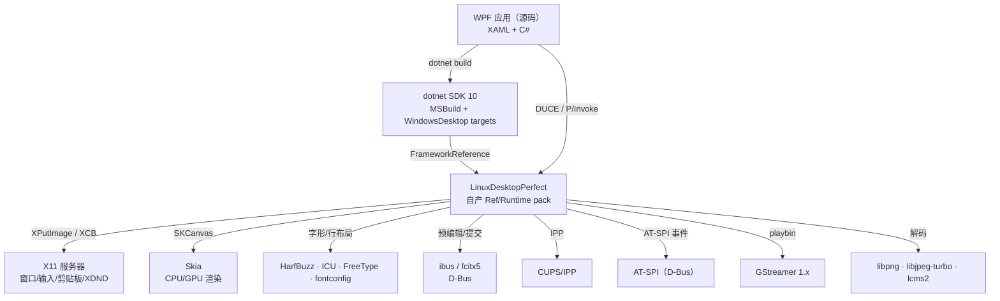
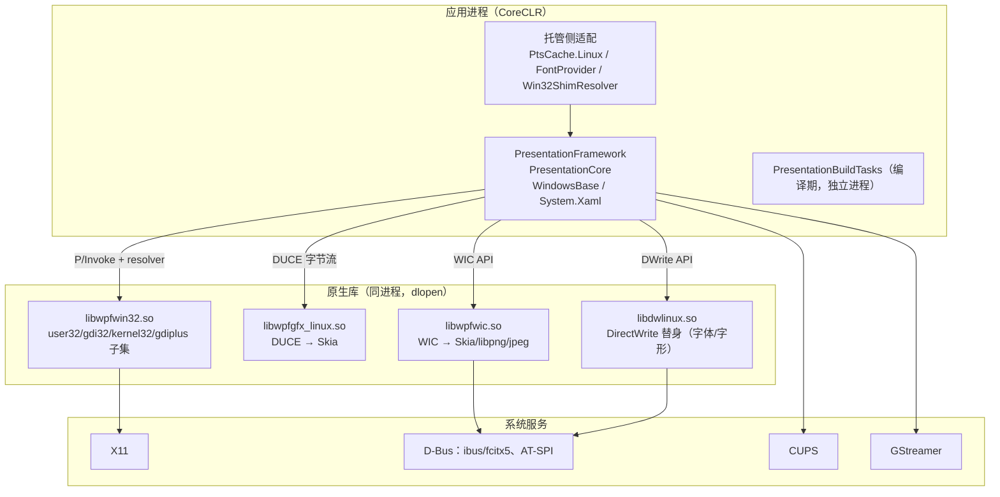

# LinuxDesktopPerfect — 概要设计

**文档状态**：V0.1（草案，待签署）
**日期**：2026-10-30
**上游**：[《需求与验收判据文档》](../20-spec/需求与验收判据文档.md) V0.1
**下游**：[《00-文档包总览与评审检查单》](设计文档包/00-文档包总览与评审检查单.md)（00–08 + 界面 + 界面图 + checks + model）

---

## 0. 文档元数据

| 项 | 内容 |
|---|---|
| 版本 | V0.1 |
| 设计范围 | WPF 托管移植、native shim、MIL 后端、文本栈、WIC/DWrite provider、框架包、WinForms 兼容层 |
| 不在本文件展开 | 逐接口字段（→ 04）、逐模块类图（→ 03）、逐 pack 文件清单（→ 02/04）、界面与无障碍树（→ 界面）、逐判据命令与测试门（→ 08 → 50-verify） |
| 编号纪律 | REQ/ACC/NF/XIF/DQ 在 `20-spec` 定义；ADR/MOD/SYS/R/SM/IF 在本文件首次定义，其余文件只引用 |
| 与需求的关系 | 每条 REQ 至少被一个 MOD 承接；§10 给追踪矩阵 |
| 基线 | .NET 10 LTS（10.0.x）；Linux x64 / X11；单仓 monorepo |

---

## 1. 设计目标、约束与原则

### 1.1 目标

1. **一份 WindowsDesktop 源码，Linux 上从编译到交互全通**：WPF 全量、WinForms 到兼容层（ADR-011）；不修改应用工程文件，产出可运行的桌面程序。
2. **框架级身份**：自产 `Microsoft.WindowsDesktop.App.Ref` / `.Runtime.linux-x64`，让 `UseWPF=true` 在 Linux 上有真实落点。
3. **12 条 Windows 专有路径全部有落点或显式降级**：DWM、UIA、XPS、DRM、DirectWrite 特性、字体回退、IME、DPI、主题、Ribbon、Media、Ink。
4. **契约稳定**：托管层与原生层只通过三个契约耦合——P/Invoke C ABI、DUCE 字节流、pack 清单；任一契约可独立版本化与对拍。
5. **可复算**：每条结论有命令；迁移与重建可重复。

### 1.2 非目标

- 二进制兼容：不加载 Windows 编的 dll/exe，不仿真 `Microsoft.WindowsDesktop.App` 的 Windows 宿主身份。
- WinForms 控件树重写：只做兼容层（加载 + 六类基础控件 + MSAA 桥），设计器、ActiveX/DCOM 不做。
- Windows IME 协议仿真：接 ibus/fcitx5。
- WMP/Media Foundation 全格式；DRM 内容播放（明确降级，D-001）。
- GTK/Qt 系统主题映射：只做 WPF 原主题视觉复刻。
- Wayland / arm64（V2 平台扩展）。

### 1.3 硬约束

| 约束 | 来源 | 设计后果 |
|---|---|---|
| 源码级重编 | 用户裁决 | 不实现 PE 加载、程序集身份仿真、BAML 跨平台回退以外的兼容层 |
| 上游只读 + applier | REQ-FN-005 | 派生树全部可再生；禁止在 `upstream/` 手改 |
| .NET 10 LTS | 用户裁决 | pack 版本、TFM、API 面全部对齐 10.0.x |
| x64 / X11 首发 | 用户裁决 | Wayland/arm64 不进 V1 判据；代码保留平台抽象层 |
| 单仓 monorepo | 用户裁决 | 四个子系统同仓；ABI 契约文件作为仓内一等资产 |
| MIT / 许可合规 | NF-006 | 上游版权头保留；GStreamer（LGPL）动态链接；字体 OFL |
| 诚实降级 | REQ-FN-030 | 不可实现路径返回明确错误码 + 缺陷册编号，禁止静默 |

### 1.4 设计原则

1. **托管层不动，只加补丁**。WPF 的 API 语义在托管层，重写托管层等于重写 WPF；补丁只放在 P/Invoke 边界、构建 targets、平台分支。
2. **进程边界即模块边界**。托管进程内的适配（`PtsCache.Linux.cs`、字体 provider）不放进原生仓；原生 `.so` 不感知 WPF 对象模型。
3. **契约先行、对拍驱动**。ABI 结构体逐字段 `_Static_assert`；DUCE 命令逐条布局对拍；pack 清单逐件 diff。
4. **先有落点，再谈性能**。CPU 渲染、X11、同步打印优先；GPU/Wayland/异步后置。
5. **降级也是功能**。每条降级必须有触发条件、返回码、用户可见行为、缺陷编号四要素。
6. **判据先行**。每个模块动工前先有失败的判据断言，再写实现让它转绿；判据不是实现完成后的补写（ADR-014）。
7. **无障碍优先**。界面在第一次开窗时就必须有可机的无障碍树；后续界面检测、回归与人工核对都以这棵树为第一判据，像素只作第二判据（ADR-015）。

---

## 2. 系统上下文与总体架构

### 2.1 上下文图



**关键读法**：应用只认识 WPF API 与 pack；所有 Windows 专有面在 RT 内部被替换。RT 不向应用暴露任何新 API。

### 2.2 运行时视图（进程边界）



**为什么同进程**：WPF 的 native 调用是同步的、按句柄的、跨调用的（窗口句柄、GDI 句柄、设备上下文），跨进程会引入代理与句柄映射，等于重写 Win32 语义。同进程 + 同名 `.so` + 运行时解析是唯一低成本路径。

### 2.3 构建视图（applier 流水线）

```text
upstream/wpf（只读快照）
   │  ① 选取 TFM/版本/程序集清单
   ▼
appliers（每项补丁一个脚本，幂等）
   │  ② 生成 build/<Assembly>.Linux.csproj
   │  ③ 写入 P/Invoke 目标名、平台常量、条件编译
   ▼
派生树 build/（可再生，不入 git）
   │  ④ dotnet build
   ▼
自产托管件（10 个）+ 自产原生件（4 个 .so）
   │  ⑤ pack 组装
   ▼
Microsoft.WindowsDesktop.App.Ref / .Runtime.linux-x64
```

**关键约束**：`build/` 是产物，不是源码；手工改会在下次 applier 运行时被覆盖（REQ-FN-005）。所有接线写在 applier 里。

### 2.4 部署视图

| 组件 | 位置 | 必需 | 说明 |
|---|---|---|---|
| 自产托管件 | pack 内 `shared/Microsoft.WindowsDesktop.App/10.0.x/` | 是 | 与官方同名同身份 |
| `libwpfwin32.so` | 应用输出目录或 pack `native/` | 是 | Win32/GDI/GDI+ 子集 |
| `libwpfgfx_linux.so` | 同上 | 是 | DUCE 渲染 |
| `libwpfwic.so` | 同上 | 是 | 图像解码 |
| `libdwlinux.so` | 同上 | 是 | 字体/字形 |
| `libSkiaSharp.so` | 应用输出目录 | 是 | 渲染后端 |
| ibus/fcitx5 | 系统 | 否 | 无 IME 时降级为直接键输入 |
| CUPS | 系统 | 否 | 无打印时 `PrintQueue` 明确报错 |
| AT-SPI | 系统 | 否 | 无无障碍总线时 UIA 桥静默禁用 |

### 2.5 资产迁移路径

```text
WPFOnLinux/src/Microsoft.DotNet.Wpf/      → 40-build/upstream/wpf/       （只读快照）
WPFOnLinux/src/WpfGfx.Linux.Native/       → 40-build/native-shim/        （C shim，56 文件）
WPFOnLinux/src/WpfGfx.Linux/              → 40-build/milcore/            （**先补源码**，DQ-002）
WPFOnLinux/src/Microsoft.DotNet.Wpf.Linux/→ 40-build/wpf-port/          （托管适配）
WPFOnLinux/src/Linux/build/               → 40-build/                    （applier/编排/判据）
WPFOnLinux/docs/                          → 90-archive/wpfonlinux/       （只读归档）
```

**迁移三条纪律**：① 先冻结基线（提交 sha + 验收读数）；② 契约文件（`win32_abi.h`、`exports.txt`、DUCE 布局表）与实现同迁；③ 迁移后原仓只读，不再双写。

**执行状态（2026-10-30）**：上游快照、milcore、native-shim 已迁入（各带 `SNAPSHOT.json`／`SOURCE.json`）；`wpf-port` 与旧 `Linux/build` 尚未迁入，属 M0 剩余项。逐项台账见[《09-开工前置与切片计划》](设计文档包/09-开工前置与切片计划.md) §2.4。

---

## 3. 架构决策记录（ADR）

### ADR-001：源码级重编，不做二进制兼容

- **背景**：二进制兼容要仿真 Windows 宿主框架（`Microsoft.WindowsDesktop.App`）、程序集版本绑定（4.0.0.0 vs 4.0.0.1）、BAML 版本头与 PE 加载；`WPFOnLinux` 已实测四道闸，任何一道都不是「再补一个 shim」能解的。
- **决策**：只保证「源码在 Linux 重编后完整运行」；不加载 Windows 编译产物。
- **后果**：①工程接入方式是「改 TFM + 用自产 pack」，不是「拷 dll 就跑」；②BAML 编译同源（自产 PBT 与官方逐字节一致）；③版本跟随上游 10.0.x。
- **否决方案**：二进制兼容——需要宿主框架仿真与绑定重定向，工作量与风险不可控，且与「完美」的判据无法对齐。

### ADR-002：上游只读，补丁全部走 applier

- **决策**：`40-build/upstream/wpf` 只读；所有改动写成幂等 applier，生成 `40-build/` 派生树。
- **后果**：①上游升级 = 换快照 + 重跑 applier + 重跑判据；②手改会被覆盖，评审必须看 applier；③applier 成为「补丁的唯一事实源」。
- **否决方案**：直接 fork 后手改——上游每个 patch 都是合并冲突，且无法复算。

### ADR-003：三个契约划定模块边界

- **决策**：托管层与原生层只通过三个契约耦合：①P/Invoke C ABI（库名 + 入口 + 结构体布局）；②DUCE 字节流（命令 id + 布局 + 资源表）；③pack 清单（文件名 + Profile + 版本）。
- **后果**：①`win32_abi.h` 的 `_Static_assert`、`exports.txt`、DUCE 布局表成为仓内一等资产，改一处必须同步对拍；②原生仓可独立测试（不需要 WPF 对象模型）；③迁移/替换任一实现不影响另外两个契约。
- **否决方案**：按「功能模块」切分（窗口/文本/渲染各一仓）——同一份 ABI 会被多处复制，契约漂移不可控。

### ADR-004：渲染后端用 Skia，不自研 GPU 栈

- **决策**：CPU 后端用 Skia；GPU 后端后置。
- **依据**：`WPFOnLinux` 已验证 `WpfTextDemo` 14/14 帧非空；自研 D3D 替代需要重写着色器/纹理/合成，与「先有落点」原则冲突。
- **后果**：①`libwpfgfx_linux.so` 只消费 DUCE、输出像素；②D3DCompiler/vcruntime 依赖自然消失；③GPU 路径后置时只替换 Skia 的 surface 实现。

### ADR-005：窗口与输入用 X11，Wayland 后置

- **决策**：X11 为 V1 唯一窗口后端；Wayland 只保留抽象层。
- **依据**：X11 的窗口句柄/消息/剪贴板/XDND 与 Win32 语义最接近；`WPFOnLinux` 的 `win32_x11.c` 是唯一 Xlib 接触点，替换成本低。
- **后果**：①`GetWindowLong`/`SetWindowPos`/`WM_*` 有直接落点；②Wayland 需要重写输入法/装饰/剪贴板路径，进 V2。

### ADR-006：自产 pack，且不改应用工程文件

- **决策**：自产 `Microsoft.WindowsDesktop.App.Ref` / `.Runtime.linux-x64`；SDK 侧只改 `BundledVersions` 的一处条件与 `Microsoft.WinFX.targets` 的 PBT 定位（或由 applier 覆盖属性）。
- **依据**：两道闸门，顺序已实测（2026-10-30）：①**第一道**是 `.NET SDK 的 NETSDK1136`（`Microsoft.NET.Sdk.DefaultItems.targets`：用 WPF/WinForms 必须 `TargetFramework` 带 `-windows`）——样本工程 `net10.0` + `UseWPF=true` 在 restore 成功后立刻被它挡住，读数见 `50-verify/读数/ACC-001/`；②**第二道**是 `BundledVersions.props` 的 `IsWindowsOnly="true"` 与只发 `win-*` RID 的 pack。
- **注意**：早先版本只写了第二道，实测第一道更靠前；applier 与 targets 必须同时处理这两道，否则连 ref pack 解析都到不了。
- **后果**：①应用只改 `TargetFramework`；②pack 必须完整（WPF 21 件 + 共享 16 件），缺一件就绑定失败；③`System.Windows.Extensions` 等必抛桩必须换自产件。

### ADR-007：文本栈 = HarfBuzz + ICU + 自研行布局

- **决策**：shaping 用 HarfBuzz（GSUB/GPOS），断行用 ICU（UAX#14），行布局/PTS 在托管侧实现 `TextFormatting.TextLine` 契约；不移植 LineServices。
- **依据**：快照实读（release/10.0 提交 2565b0112）：两个别名合计 165 条声明（`DllImport.PresentationNative` 126 + `PresentationNativeDll` 39），去重入口 145 个（126 + 19，无重名）；126 条分类为 66 `Fs*` + 23 `Lo*` + 6 `Nl*` + 31 其他。原「147 声明 / 100 缺失」口径无法复现，已作废；且 LineServices 源码不在公开仓。
- **后果**：①`FlowDocument`/`RichTextBox` 走托管行布局；②复杂脚本的 shaping 回调进 `TextAnalyzer`；③CFF 轮廓走 FreeType。

### ADR-008：IME 接 ibus/fcitx5

- **决策**：通过 D-Bus 接入 ibus/fcitx5 的预编辑/提交/候选窗接口；不实现 IMM32/Tsf。
- **后果**：①`TextCompositionManager` 的预编辑事件由桥接层产生；②候选窗定位由 X11 窗口坐标换算；③无 IME 时直接键输入。

### ADR-009：Media 用 GStreamer

- **决策**：`MediaElement`/`MediaPlayer` 接 GStreamer `playbin`；不保证 WMP/Media Foundation 全格式。
- **后果**：①播放/暂停/定位/音量映射到 GStreamer 状态机；②不支持格式明确报错并登记；③DRM 媒体不承诺（DQ-001）。

### ADR-010：主题视觉复刻，不映射系统主题

- **决策**：Aero/Aero2/AeroLite/Luna/Royale/Classic 按 WPF 原资源实现；不读取 GTK/Qt 主题。
- **后果**：①主题 BAML 与资源字典保持上游；②字体/DPI 仍走 fontconfig/DPI 换算；③用户自定义主题走 WPF 资源覆盖机制。

### ADR-011：WinForms 只做兼容层

- **决策**：WinForms 的验收边界 = 加载 + 核心六控件（Button/TextBox/ListBox/ComboBox/Form/Menu）+ 常用控件 + MSAA→AT-SPI 桥；未实现控件在控制台输出错误并渲染空白占位，**不崩溃**；不做设计器、ActiveX/DCOM、控件树重写。
- **依据**：WinForms 控件是 USER32/GDI 包装，不是自绘；`System.Drawing.Common` 在 .NET 7+ 非 Windows 默认抛 `PlatformNotSupportedException`。
- **后果**：①`System.Windows.Forms` 的 Win32 调用走同一套 `libwpfwin32.so`；②GDI+ 走 `libgdiplus`/自绘；③缺失控件走「报错 + 空白占位」路径，错误行带控件名与 `D-xxx`，不是静默。

### ADR-012：诚实降级 + 缺陷册

- **决策**：不可实现路径返回明确错误码（`E_NOTIMPL`/`PlatformNotSupported`），并在 `70-operate/已知坑清单.md` 登记编号、触发条件、返回码。
- **后果**：①不允许「静默返回空/假成功」；②验收时「降级项」与「失败项」分开统计；③缺陷册是判据的一部分，不是附件。

### ADR-013：文档与名称契约机器化

- **背景**：多 Agent、多人维护时，术语漂移、死链、跨文件编号悬空会让设计基线悄悄失效；靠人工评审不可复算。
- **决策**：名称以[《术语表》](../00-admin/术语表.md)为准，引用以[《引用与名称规范》](../00-admin/引用与名称规范.md)为准；两条检查器（[#链接检查器](checks/check-links.mjs)、[#文档包检查器](checks/check-package.mjs)）与[#自检](checks/selftest.mjs)是交付门禁。
- **后果**：①新增文档必须在[#名称清单](model/names.json)登记；②编号只在定义方定义，引用悬空即红；③裸 `.md` 路径、裸行号、死链 `rc=1`；④改规则先改自检的负向断言。
- **否决方案**：靠评审人工检查——不可复算，且 Agent 改文档时无人兜底。

### ADR-014：判据先行（先红后绿），判据是产出的第一等交付物

- **背景**：本项目的验收对象是 Windows 行为等价（12 项专有面、118 条 DUCE 命令、30 条验收判据），不是「能编译」。若实现先写、判据后补，判据会跟着实现走形——失败条件被写成「当前行为即正确」，等价性判据退化为自证。多人/多 Agent 并行时，这一点尤其致命：没有先写下的失败断言，谁也无法判断某条路径「实现了」还是「碰巧没崩」。
- **决策**：每个 MOD 动工顺序固定为①判据断言（写死输入、期望、失败判据、读数落点）→②跑出红读数并落盘→③写实现→④转绿→⑤回归。判据与状态登记进[《08-判据先行与界面检测设计说明》](设计文档包/08-判据先行与界面检测设计说明.md) 的测试门（TG-001~TG-015）；一条 ACC 在转绿前，状态一律写「待实现」，不得写「已支持」。
- **后果**：①`50-verify/` 先于 `40-build/` 出现可执行判据，红读数也是交付物；②每个判据必须能独立复算（单行命令 + 落盘读数），禁止只在交互界面里手工点一遍；③契约对拍（`exports.txt`、`win32_abi.h`、DUCE 布局表、`FrameworkList`）属于 `TG-001`，先于所有功能实现；④桩件与假件（Fake X11、Fake AT-SPI、Fake CUPS）是设计资产，不是测试临时代码。
- **否决方案**：实现优先、判据后补——判据会向实现妥协，等价性判据无法审计；这正是前身仓（WPFOnLinux）验收读数散落、结论不可复算的成因。

### ADR-015：无障碍优先——AT-SPI 树是界面的第一可机判据

- **背景**：本项目的界面不是自己画的产品界面，而是「用 WPF 样本程序在 Linux 上真实画出的界面」。要判断界面是否真的成立，只有两条路：像素比对（受字体、DPI、合成器、GPU 影响，阈值永远说不清）与结构比对（控件树的角色/名称/状态/动作，与平台无关）。WPF 本身已经有完整的 `AutomationPeer` 语义，UIA → AT-SPI 桥是必须交付的路径（REQ-FN-027），这条路同时把界面变成了可机读的结构。
- **决策**：界面判据以 AT-SPI 无障碍树为第一判据，像素为第二判据。具体：①每个样本界面（SCR-01~SCR-07）在[《界面设计说明》](设计文档包/界面设计说明.md)登记元素属性表（角色/名称/状态/动作/检测判据），该表即可机读期望；②无障碍桥（MOD-81/63/86）与首个窗口同期实现，不排到 M5 之后；③回归先比结构（树快照 diff），结构不一致才用帧比对定位视觉问题；④结构性检测先于视觉检测，视觉阈值只覆盖结构表达不了的属性（如渐变、阴影）。
- **后果**：①无障碍桥从「最后一项专有面」变成「第二条先做的路径」（与首帧同期）；②`accerciser`/Orca 的人工核对与自动化快照共用同一棵树，结论一致；③像素基线的维护量下降，因为结构变化先被拦住；④UIA 语义与 AT-SPI 角色的映射表（TBL-012）成为契约资产，缺失角色必须登记缺口（GAP）。
- **否决方案**：只做像素比对——阈值不可复算、字体与 DPI 差异不可归因，且退化成一个「看起来像」的判据；只做人工核对——不可复算，Agent 无法在无人值守时判断界面是否成立。


---

## 4. 子系统与模块

### 4.1 总览

| 系统 | 职责 | 语言 | 产物 |
|---|---|---|---|
| SYS-1 wpf-port | 上游派生、托管适配、PBT、applier | C# / MSBuild | 10 个自产托管件 |
| SYS-2 native-shim | Win32/GDI/GDI+/kernel32 子集、消息泵 | C | `libwpfwin32.so` |
| SYS-3 milcore | DUCE → Skia 渲染、资源表、窗口呈现 | C#（AOT） | `libwpfgfx_linux.so` |
| SYS-4 text-stack | 字体/字形/行布局/PTS 替代 | C# + C | `libdwlinux.so` + 托管 |
| SYS-5 wic-dwrite | 图像解码、ICC、字体 provider | C | `libwpfwic.so` |
| SYS-6 pack | Ref/Runtime pack、targets、安装 | MSBuild | 2 个 NuGet pack |
| SYS-7 winforms-compat | 加载、六控件、MSAA 桥 | C# | 兼容层程序集 |
| SYS-8 service-adapters | 打印/媒体/Ink/UIA/IME/DRM 的系统接入 | C# + C | 链接进 pack，无独立产物 |

### 4.2 SYS-1 wpf-port

| 模块 | 职责 | 输入 | 输出 |
|---|---|---|---|
| MOD-01 派生生成 | 从上游生成 `build/*.Linux.csproj` | upstream + applier | 派生树 |
| MOD-02 P/Invoke 适配 | 库名映射、resolver、平台分支 | `RefAssemblyAttrs.cs` + applier | 托管件 |
| MOD-03 PBT | XAML/BAML 编译（自产 `PresentationBuildTasks`） | `.xaml` | `.baml` / `.g.cs` |
| MOD-04 打包契约 | 程序集清单、身份、版本 | 上游版本表 | pack 输入清单 |
| MOD-05 补丁测试 | 每个 applier 的回归 | 派生树 | 判据读数 |
| MOD-06 判据先行脚手架 | 判据断言模板、桩件/假件（Fake X11/AT-SPI/CUPS）、红读数落盘 | `50-verify/` 目录约定 + [《08-判据先行与界面检测设计说明》](设计文档包/08-判据先行与界面检测设计说明.md) | 可复算判据与读数 |

### 4.3 SYS-2 native-shim

| 模块 | 职责 |
|---|---|
| MOD-11 窗口与类 | 窗口表、类注册、样式、GWL_*、焦点 |
| MOD-12 消息泵 | 队列、定时器、窗口过程派发、XEvent→MSG 翻译 |
| MOD-13 GDI | DC、位图、绘制、字体度量、DPI |
| MOD-14 GDI+ | `gdiplus.dll` 子集（经 libgdiplus 或自绘） |
| MOD-15 kernel32 子集 | 文件/时间/线程/环境/模块 |
| MOD-16 PTS 桩 | `Lo*`/`Fs*`/`Nl*` 的显式缺口与降级 |
| MOD-17 ABI 契约 | `win32_abi.h` 逐字段断言 + `exports.txt` |

### 4.4 SYS-3 milcore

| 模块 | 职责 |
|---|---|
| MOD-21 DUCE 解码 | 118 条命令 → 资源/绘制指令 |
| MOD-22 资源表 | 句柄、引用计数、视觉树投影 |
| MOD-23 Skia 后端 | 画刷/几何/变换/效果 → SKCanvas |
| MOD-24 窗口呈现 | 帧合成 → XPutImage/XCB |
| MOD-25 导出层 | `exports.cs` 的 18 个 Mil* 入口 |

### 4.5 SYS-4 text-stack

| 模块 | 职责 |
|---|---|
| MOD-31 字体枚举 | fontconfig → WPF 字体族/回退链 |
| MOD-32 shaping | HarfBuzz 回调 → `TextAnalyzer` |
| MOD-33 行布局 | `TextLine`/`FullTextLine` 契约实现 |
| MOD-34 段落/PTS | `PtsCache` 的 Linux 实现与降级 |
| MOD-35 CFF | FreeType 轮廓 → `MilFontFace` |
| MOD-36 IME | ibus/fcitx5 D-Bus：预编辑/提交/取消/候选窗 |

### 4.6 SYS-5/6/7/8

| 模块 | 职责 |
|---|---|
| MOD-41 WIC 解码 | png/jpeg/gif/bmp/tiff → Skia |
| MOD-42 ICC | lcms2 色彩转换 |
| MOD-51 Ref pack | 21 WPF + 19 共享 + 1 无 Profile（2026-10-30 实读复核，原写 16） |
| MOD-52 Runtime pack | 托管件 + 4 个 `.so` + 依赖声明 |
| MOD-53 targets | `UseWPF` 解析、PBT 定位、RID 条件 |
| MOD-61 兼容层加载 | `System.Windows.Forms` 程序集与初始化 |
| MOD-62 六控件 | Button/TextBox/ListBox/ComboBox/Form/Menu |
| MOD-63 MSAA 桥 | `oleacc` → AT-SPI |
| MOD-81 UIA 桥 | `UIAutomationProvider` → AT-SPI 角色/名称/动作 |
| MOD-82 打印 | XPS 渲染 → CUPS/IPP |
| MOD-83 媒体 | GStreamer `playbin` 状态机 |
| MOD-84 Ink | libinput/XInput2 + `PenImc` 替身 |
| MOD-85 DRM 桩 | `MsDrm` 入口的显式错误（DQ-001） |
| MOD-86 界面可检测契约 | AT-SPI 树快照、元素属性表、检测探针与结构 diff（ADR-015） |

---

## 5. 12 项 Windows 专有面的落点

| # | 面 | Linux 落点 | 模块 | 判据 |
|---|---|---|---|---|
| 1 | DWM | X11 合成器检测；无合成时 `DwmIsCompositionEnabled=false` 路径 | MOD-11/24 | ACC-026 |
| 2 | UIA | UIAutomationCore → AT-SPI 桥，树快照即界面判据 | MOD-81/63/86 | ACC-027 |
| 3 | XPS 打印 | XPS 渲染 + CUPS/IPP | MOD-24/82 | ACC-024 |
| 4 | DRM | 明确降级：`E_NOTIMPL` + 缺陷册 D-001 | MOD-85 | ACC-030 |
| 5 | DirectWrite 特性 | HarfBuzz 特性集 + fontconfig 回退 | MOD-31/32 | ACC-013/014 |
| 6 | 字体回退 | fontconfig 回退链 + FreeType | MOD-31 | ACC-013 |
| 7 | 输入法 | ibus/fcitx5 D-Bus | MOD-36 | ACC-017 |
| 8 | DPI | per-monitor 缩放 + Xft.dpi | MOD-13/24 | ACC-011 |
| 9 | 主题 | Aero/Aero2/AeroLite/Luna/Royale/Classic 资源 | MOD-04 | ACC-020 |
| 10 | Ribbon | 上游 Ribbon 程序集 + 主题资源 | MOD-04 | ACC-021 |
| 11 | Media | GStreamer `playbin` | MOD-83 | ACC-022 |
| 12 | Ink | libinput/XInput2 + `PenImc` 替身 | MOD-15/84 | ACC-023 |

> 表中未列的 `MsDrm`（49 条 P/Invoke）、`PrntvPt`（7 条）、`Mscms`（9 条）分别并入 DRM、XPS、ICC 三条路径。

---

## 6. 关键流程

### 6.1 应用启动

```text
dotnet app.dll
  → host 解析 runtimeconfig（Microsoft.WindowsDesktop.App/10.0.x）
  → 加载自产 PresentationFramework/Base
  → Application.Run()
  → X11 建窗（libwpfwin32）→ 消息泵
  → 首次布局 → DUCE 命令 → libwpfgfx_linux → Skia → XPutImage
```

**失败点**：pack 版本不匹配（绑定失败）、`libSkiaSharp.so` 缺失、X11 连接失败——三者都必须有明确错误行。

### 6.2 文本渲染

```text
TextBlock → TextFormatter → TextLine（托管实现）
  → HarfBuzz shaping（MOD-32）
  → 字形轮廓（FreeType / CFF）
  → MilGlyphRun 命令 → DUCE → Skia
```

### 6.3 IME

```text
X11 键盘事件 → libwpfwin32 → TextCompositionManager
  → D-Bus（ibus/fcitx5）：预编辑/提交/取消
  → 候选窗定位（窗口坐标 → X11 屏幕坐标）
```

### 6.4 打印

```text
PrintDialog → XPS 文档 → XPS 渲染（MOD-24）
  → CUPS IPP（打印到队列或 PDF）
```

### 6.5 无障碍

```text
WPF AutomationPeer → UIAutomationProvider
  → AT-SPI 桥：角色/名称/状态/动作
  → accerciser / Orca 可查询
```

---

## 7. 接口概览

| 接口 | 形态 | 版本化方式 |
|---|---|---|
| P/Invoke ABI | 库名 + 入口 + 结构体布局 | `exports.txt` + `win32_abi.h` 的 `_Static_assert` |
| DUCE | 命令 id + 字节布局 + 资源表 | 布局表 + 逐命令对拍 |
| pack | NuGet 布局 + `FrameworkList` + `runtimeconfig` | pack 版本 + 清单 diff |
| IME | ibus/fcitx5 D-Bus | 接口版本探测 |
| 打印 | CUPS IPP | CUPS API 版本 |
| 无障碍 | AT-SPI D-Bus | AT-SPI 版本 |
| 媒体 | GStreamer 1.x | `gst_version` 探测 |

**三条硬规则**：①入口名与结构体布局不得「大致一致」，必须逐字段；②未实现入口必须显式导出（返回错误）或从 `exports.txt` 中列为缺口，不允许「找不到符号就崩」；③pack 清单缺件视为构建失败，不静默跳过。

---

## 8. 安全与合规

- **许可**：上游 MIT 版权头保留；GStreamer LGPL 动态链接；字体 OFL；libgdiplus MIT。
- **不引入闭源二进制**：不使用 DncEng transport 包中的 `_cor3.dll`；闭源件只作为「对照基准」在隔离目录，不进入产物。
- **无提权**：安装到用户目录或 `/usr/lib` 需显式系统包；运行时不要求 root。
- **输入边界**：IBus/AT-SPI 消息做长度与类型校验；打印路径不做任意文件写。
- **DRM**：不自研、不绕过；DQ-001 决定后同步更新本节。

---

## 9. 风险

| 编号 | 风险 | 影响 | 处置 |
|---|---|---|---|
| R-001 | `WpfGfx.Linux` 源码未入库（git 0 tracked） | milcore 无法重建，整个渲染子系统不可验收 | DQ-002：先找回源码；找不到则重写（工作量最大） |
| R-002 | PresentationNative 100 个入口无源码、无 ABI 文档 | 文本分析/PTS 只能按声明名反推 | 托管侧行布局替代 + 缺口登记；不做「逐入口补齐」承诺 |
| R-003 | `System.Drawing.Common` 非 Windows 必抛 | WPF 图像互操作与 WinForms 兼容层阻断 | 自产 Unix 版或包内替换；优先 `System.Private.Windows.GdiPlus` |
| R-004 | UIA→AT-SPI 语义差异大 | 无障碍只覆盖控件级，不保证像素级 | 明确定义 8 类控件的判据，其余降级 |
| R-005 | DPI/字体度量与 Windows 有差异 | 布局与视觉对照超阈值 | 以「DPI 换算正确 + 基准帧 AE 阈值」为判据，不承诺逐像素 |
| R-006 | GStreamer 依赖系统版本 | 媒体路径在不同发行版漂移 | 锁 GStreamer 1.20+；缺库时明确报错 |
| R-007 | 上游 10.0.x patch 改变 P/Invoke 面 | applier 失效 | 每个 patch 跑契约对拍；契约变化进变更记录 |
| R-008 | X11 无合成器/远程会话 | DWM 语义与帧呈现降级 | 明确降级路径；远程 Xvfb 有判据 |
| R-009 | DRM 裁决未定 | 范围与判据悬空 | DQ-001 签署前不进入验收 |
| R-010 | WinForms 兼容层被误读为「全 WinForms」 | 验收预期错位 | ADR-011 写死核心六控件 + 常用控件；缺失控件报错占位不崩溃 |
| R-011 | 术语漂移/死链/编号悬空 | 设计基线悄悄失效 | ADR-013：检查器 + 自检 + 评审 |
| R-012 | 无障碍树与视觉界面不一致（树说对、画错，或反之） | 「结构判据绿、界面实际坏」或「界面好、判据红」 | ADR-015：结构 + 帧双判据，结构不一致先定位再比帧；不一致项进 GAP |
| R-013 | 判据先行被绕过（实现先写、判据后补成自证） | 等价性判据退化为「当前行为即正确」 | ADR-014：红读数必须落盘才允许动实现；TG-001 契约对拍先于功能；评审看红读数时间戳 |

---

## 10. 追踪矩阵（REQ → MOD）

| REQ | 承接模块 | 判据 |
|---|---|---|
| REQ-FN-001/002/003/004/005 | MOD-01/02/04/51/52/53 | ACC-001~005 |
| REQ-FN-006/007/008 | MOD-21/22/23/24/25 | ACC-006~008 |
| REQ-FN-009/010/011/012 | MOD-11/12/13/24 | ACC-009~012 |
| REQ-FN-013~017 | MOD-31~36 | ACC-013~017 |
| REQ-FN-018/019 | MOD-41/42 | ACC-018/019 |
| REQ-FN-020/021 | MOD-04 | ACC-020/021 |
| REQ-FN-022/023/024/025 | MOD-83/84/82/33 | ACC-022~025 |
| REQ-FN-026/027 | MOD-11/24/81/63/86 | ACC-026/027 |
| REQ-FN-028 | MOD-61/62/63 | ACC-028 |
| REQ-FN-029/030 | 全模块 + MOD-05/06 | ACC-029/030 |

---

## 11. 裁决结果（DQ，2026-10-30 关闭）

| 编号 | 问题 | 结论 | 影响 |
|---|---|---|---|
| DQ-001 | DRM 处置 | 明确降级：`E_NOTIMPL` + 缺陷册 D-001；不自研、不绕过 | §5 第 4 行、§8 |
| DQ-002 | milcore 源码 | 找回并入库；找不到则 M0 出口重评 | R-001、M0 |
| DQ-003 | WinForms 边界 | 核心六控件 + 常用控件；缺失控件报错 + 空白占位，不崩溃 | ACC-028、ADR-011 |
| DQ-004 | 上游同步 | 跟随每个 10.0.x patch | applier 维护成本 |

## 12. 里程碑（阶段门，不承诺日期）

| 阶段 | 出口条件 | 对应判据 |
|---|---|---|
| M0 冻结与迁移 | 基线 sha、验收读数、资产清单冻结；milcore 源码结论 | DQ-002 关闭 |
| M1 能编能开窗 | 自产件 0 error；X11 开窗；首帧非空；AT-SPI 树快照可导出（ADR-015 提前） | ACC-001/006/007/009/027 |
| M2 文本与输入 | 字体回退、shaping、行布局、IME 四路径 | ACC-013~017 |
| M3 图像/主题/控件 | WIC、ICC、六主题、Ribbon | ACC-018~021 |
| M4 打印/媒体/Ink | XPS/CUPS、GStreamer、Ink | ACC-022~024 |
| M5 无障碍全量与合成 | 8 类控件角色/名称/动作/事件全通；合成降级路径 | ACC-026/027 |
| M6 框架包与兼容层 | pack 安装 + WinForms 六控件 | ACC-002~005/028 |
| M7 全量验收 | 30 条 ACC 全绿或降级登记 | 全部 |

---

## 附录 A 编号纪律

| 前缀 | 含义 | 定义方 |
|---|---|---|
| REQ-FN / ACC / NF / XIF / DQ | 需求、验收、非功能、外部接口、裁决 | `20-spec` |
| ADR / MOD / SYS / R | 架构决策、模块、系统、风险 | 本文件 |
| SM | 状态机（SM-001~SM-008） | [《03-软件设计说明》](设计文档包/03-软件设计说明.md) §4 |
| IF | 内外部接口（IF-001~IF-073） | [《04-接口设计说明》](设计文档包/04-接口设计说明.md) |
| TBL | 契约清单、运行时表与读数表（TBL-001~TBL-012） | [《05-数据与清单设计说明》](设计文档包/05-数据与清单设计说明.md) |
| SAFE | 安全要求（SAFE-001~SAFE-020） | [《06-安全性设计支撑材料》](设计文档包/06-安全性设计支撑材料.md) |
| SCR / GAP | 可检测界面与缺口（SCR-01~SCR-07、GAP-001~GAP-012） | [《界面设计说明》](设计文档包/界面设计说明.md) |
| TG | 测试门（TG-001~TG-015） | [《08-判据先行与界面检测设计说明》](设计文档包/08-判据先行与界面检测设计说明.md) |
| D / K / X | 降级、已知坑、待裁决 | [《已知坑与降级清单》](../70-operate/已知坑清单.md) |

## 附录 B 术语

见 `20-spec/需求与验收判据文档.md` §3。
