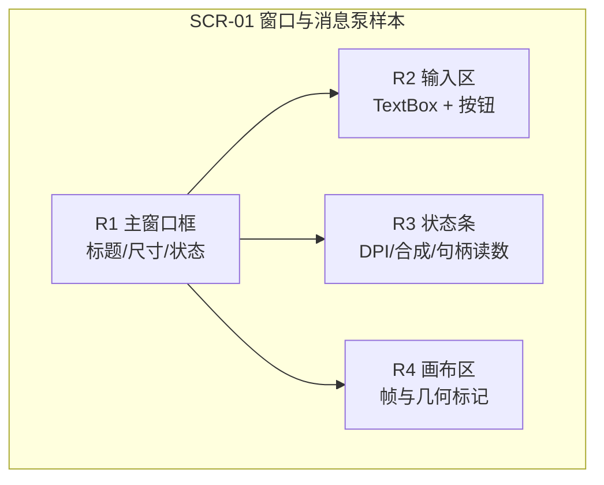
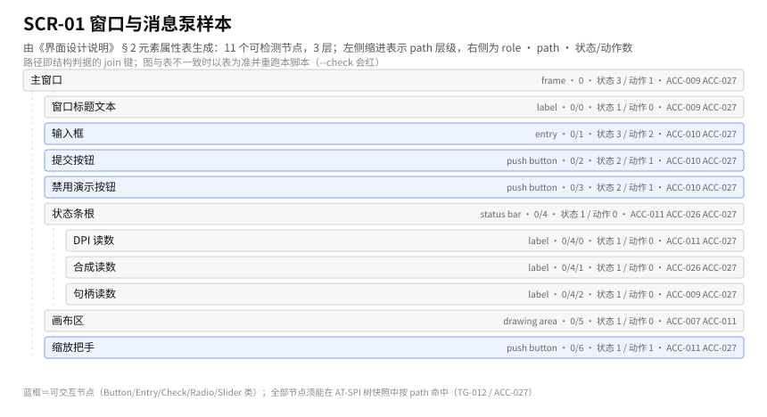
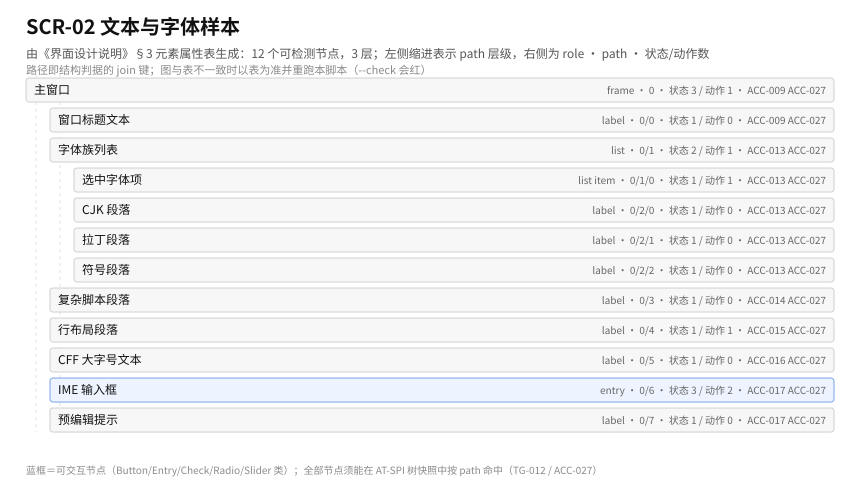
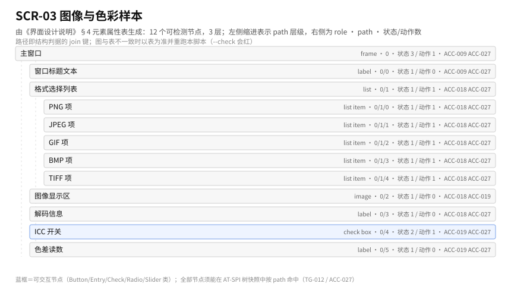
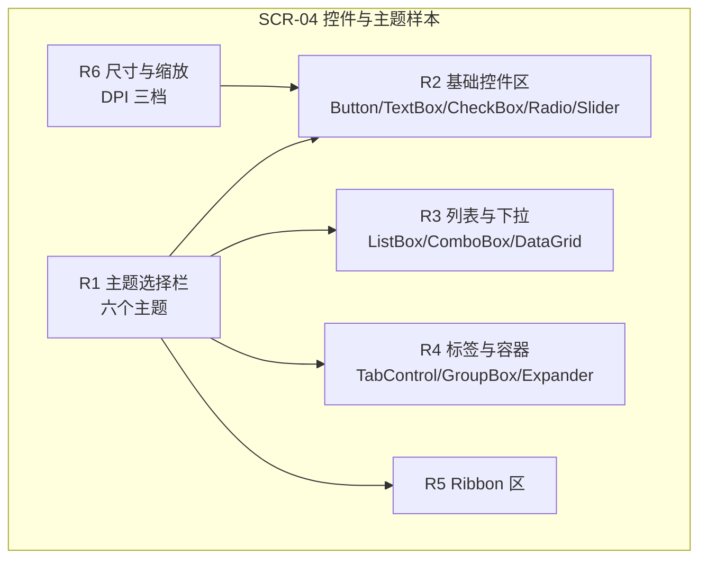
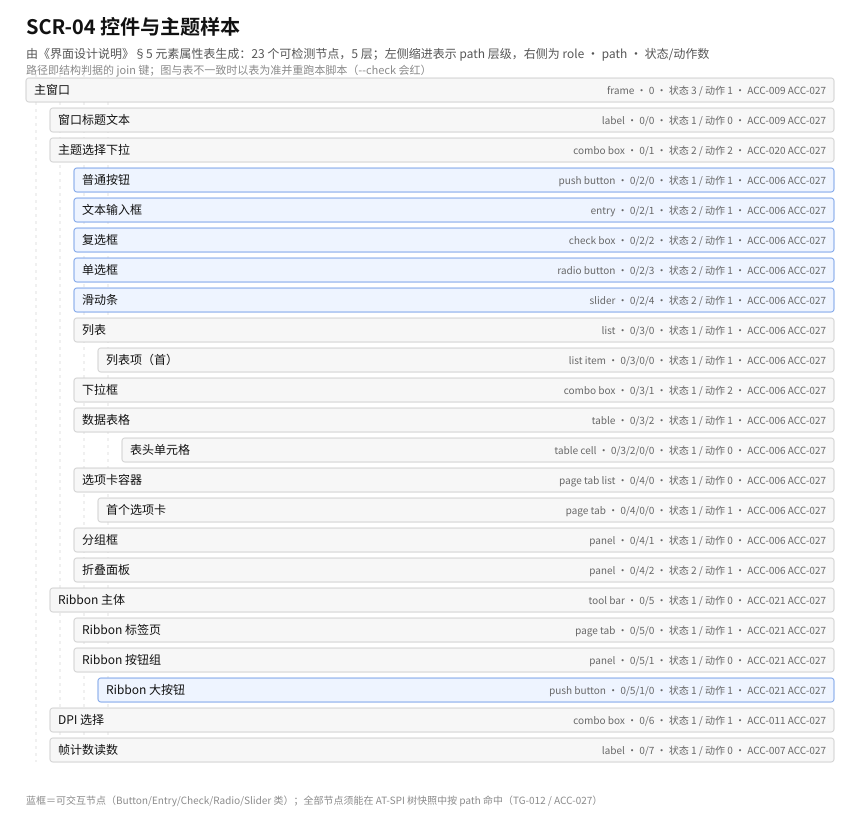
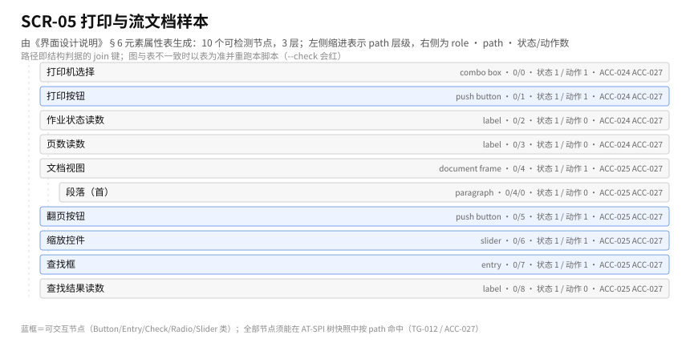
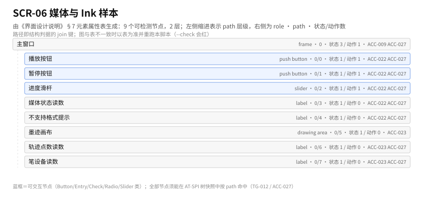
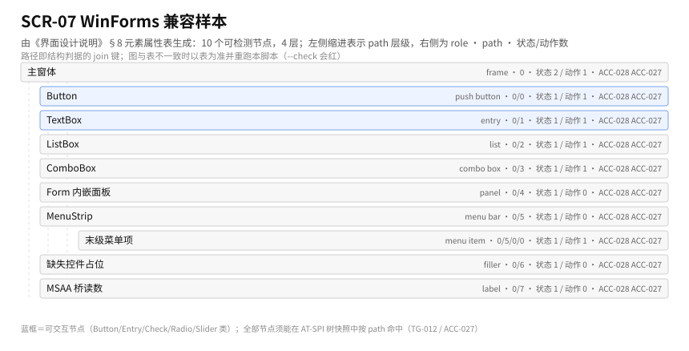

# 界面设计说明

| 项 | 内容 |
|---|---|
| 文档版本 | V0.1（草案，待签署） |
| 日期 | 2026-10-30 |
| 上游 | [《需求与验收判据文档》](../../20-spec/需求与验收判据文档.md) §4、[《概要设计》](../概要设计.md) ADR-015、[《04-接口设计说明》](04-接口设计说明.md) §7、[《05-数据与清单设计说明》](05-数据与清单设计说明.md) §3.10/§3.12 |
| 下游 | [《08-判据先行与界面检测设计说明》](08-判据先行与界面检测设计说明.md) §3、`50-verify/probe/`、`50-verify/a11y/` |
| 本文定义 | `SCR-01~SCR-07`（可检测界面）、`GAP-001~GAP-012`（界面/契约缺口） |

---

## 0. 范围与约定

### 0.1 本项目的「界面」是什么

LinuxDesktopPerfect 没有自己的产品界面。本文说的界面，是**用 WPF 样本工程在 Linux 上真实画出来的那一屏**——它既是功能证明，也是判据对象。

因此本文不描述视觉稿，只描述两件事：

1. **区域划分**：一屏由哪几块组成，块与块之间怎么走（人读）。
2. **元素属性表**：每个可检测元素的路径、角色、名称、状态、动作、判据与对端（机读）。

### 0.2 图与表的关系

区域图只表达「怎么分块、怎么走」；取值、状态、动作、判据以元素属性表为准。图与表冲突时以表为准，并在 §10 登记待修。

### 0.3 元素属性表怎么读

七列表头固定，顺序不得调整（[#覆盖检查器](../checks/check-coverage.mjs) 按表头识别）：

| 列 | 含义 | 谁用它 | 允许值 |
|---|---|---|---|
| 元素 | 人读的元素名（中文） | 人 | 自由 |
| 路径 `path` | 树内稳定路径，由根按树序编号（`0/1/2`） | 检测脚本 | 数字段，`/` 分隔 |
| 角色 | AT-SPI 角色（经 [#无障碍角色映射表](05-数据与清单设计说明.md) §3.12 从 WPF 自动化对端映射） | 结构判据 | AT-SPI 角色名 |
| 名称期望 | `AutomationPeer.GetName()` 的期望文案；含动态量时写正则 | 结构判据 | 文案或正则 |
| 状态期望 | 期望的 AT-SPI 状态位（`!` 前缀表示必须不含） | 结构判据 | 状态位集合 |
| 动作 | 期望可调用的动作，检测时逐个调用并观察效果 | 结构判据 | `click`/`set-text`/`select`/`expand`/`focus`/`scroll` |
| 判据 | 该行由哪条验收判据与测试门判定 | 追溯 | `ACC-xxx` + `TG-xxx` |

**路径纪律**：`path` 是检测的 join 键，一旦登记不得随意改；改路径等于改判据，按 [《08-判据先行与界面检测设计说明》](08-判据先行与界面检测设计说明.md) §5 的变更纪律处理。

### 0.4 缺口的编号与处置

`GAP-001~GAP-012` 表示「界面需要、但当前契约或 AT-SPI 语义表达不了」的条目。处置固定为：**登记 + 降级判据 + 不静默**。缺口不修不阻塞交付，但必须出现在 §9.3 与 [#缺陷登记表](05-数据与清单设计说明.md) §3.8 的核对里（REQ-FN-030）。

### 0.5 检测方式：结构优先

- **第一判据**：AT-SPI 树快照与本文元素属性表按 `path` 逐行比对（角色/名称/状态/动作/值/关系六列）。
- **第二判据**：帧。只用于树表达不了的属性（渐变、阴影、圆角、合成效果）与分叉定位。
- **不做的**：OCR、模板匹配、像素级逐点比对。

这条顺序的后果要写清楚：**一个界面如果树是空的，即使看起来对，也判红**。这是 ADR-015 的取舍，不是疏漏。

---

## 1. 界面清单

| 编号 | 界面 | 一句话目的 | 样本工程 | 主要模块 | 判据 |
|---|---|---|---|---|---|
| SCR-01 | 窗口与消息泵样本 | 证明开窗、消息、焦点、DPI、剪贴板在 X11 上真的成立 | `samples/WpfFirstWindow` | MOD-11/12/13/24 | ACC-009~012、ACC-026、ACC-027 |
| SCR-02 | 文本与字体样本 | 证明字体回退、shaping、行布局、CFF、IME 出字正确 | `samples/WpfTextDemo` | MOD-31~36 | ACC-013~017、ACC-027 |
| SCR-03 | 图像与色彩样本 | 证明五格式解码与 ICC 转换正确 | `samples/WpfImageGallery` | MOD-41/42 | ACC-018~019、ACC-027 |
| SCR-04 | 控件与主题样本 | 证明 DUCE 全量、六主题、Ribbon、DPI 组合成立 | `samples/WpfControlGallery` | MOD-21~25、MOD-04 | ACC-006~008、ACC-020~021、ACC-027 |
| SCR-05 | 打印与流文档样本 | 证明 XPS→CUPS 与 `FlowDocument` 分页缩放查找成立 | `samples/WpfPrintDoc` | MOD-82、MOD-33/34 | ACC-024~025、ACC-027 |
| SCR-06 | 媒体与 Ink 样本 | 证明 GStreamer 状态机与笔迹采集成立 | `samples/WpfMediaInk` | MOD-83/84 | ACC-022~023、ACC-027 |
| SCR-07 | WinForms 兼容样本 | 证明兼容层能加载、六控件可用、缺失控件不崩 | `samples/WinFormsBasics` | MOD-61/62/63 | ACC-028、ACC-027 |

**为什么是 7 个而不是 1 个**：一个巨型样本（「WPF 展示厅」）在出问题时分不清是渲染、文本、还是桥坏；分 7 个后，每个门的红读数直接落在对应 SPR 上，归因成本从「全量排查」降到「看一个样本」。

**样本工程规格**（每个 SCR 的文件清单、启动参数、期望树路径）见[《09-开工前置与切片计划》](09-开工前置与切片计划.md) §7；本文只定界面与元素期望，不定样本怎么建。

**为什么每个 SCR 都要进无障碍判据**：无障碍桥（MOD-81/63/86）的覆盖面不能靠单个界面证明。SCR-01~SCR-07 合起来覆盖 Button、TextBox、ListBox、ComboBox、Form、Menu（WinForms 六控件）+ Ribbon、TabControl、Slider、DataGrid（WPF 常用）共 10 类对端，超过 REQ-FN-027 要求的 8 类。

---

## 2. SCR-01 窗口与消息泵样本

### 2.1 目的

这一屏只做一件事：证明「窗口真的存在、消息真的到、几何真的对」。它是最早可跑起来的界面（M1），也是无障碍树的第一份快照来源（ADR-015 提前）。

### 2.2 区域划分

### 2.3 元素属性表

结构图（由下表生成，`--check` 校验同步）：

| 元素 | 路径 `path` | 角色 | 名称期望 | 状态期望 | 动作 | 判据 |
|---|---|---|---|---|---|---|
| 主窗口 | `0` | frame | `WpfFirstWindow` | `showing`、`active`、`!iconified` | `focus` | ACC-009、ACC-027（TG-004/TG-012） |
| 窗口标题文本 | `0/0` | label | 与标题一致 | `visible` | — | ACC-009、ACC-027 |
| 输入框 | `0/1` | entry | `输入样本` | `enabled`、`editable`、`focusable` | `set-text`、`focus` | ACC-010、ACC-027 |
| 提交按钮 | `0/2` | push button | `提交` | `enabled`、`sensitive` | `click` | ACC-010、ACC-027 |
| 禁用演示按钮 | `0/3` | push button | `不可用示例` | `!enabled`、`!sensitive` | —（负向断言） | ACC-010、ACC-027 |
| 状态条根 | `0/4` | status bar | `状态` | `visible` | — | ACC-011、ACC-026、ACC-027 |
| DPI 读数 | `0/4/0` | label | 正则 `DPI [0-9]{3} \([0-9]{2,3}%\)` | `visible` | — | ACC-011、ACC-027 |
| 合成读数 | `0/4/1` | label | 正则 `composite=(true\|false)` | `visible` | — | ACC-026、ACC-027 |
| 句柄读数 | `0/4/2` | label | 正则 `hwnd=0x[0-9a-f]+` | `visible` | — | ACC-009、ACC-027 |
| 画布区 | `0/5` | drawing area | `几何画布` | `visible` | — | ACC-007、ACC-011（帧判据） |
| 缩放把手 | `0/6` | push button | `放大 150%` | `enabled` | `click` | ACC-011、ACC-027 |

**为什么状态条要暴露 DPI 与合成读数**：这两项在 AT-SPI 里没有标准属性（见 GAP-001），只能以文本节点形式暴露。这样结构判据就能覆盖 DWM 与 DPI 的一部分结论，而不是全推给日志。

### 2.4 交互闭环（检测脚本序列）

1. **进入**：启动样本 → 等窗口 `frame` 出现（超时 15 s 判红）→ 抓第一份树快照 `tree-SCR-01.json`。
2. **几何**：依次 `focus` 主窗口 → `click` 缩放把手 → 断言窗口 `bounds` 与 125%/150%/200% 三档换算一致（ACC-011）。
3. **输入**：对输入框 `set-text` → 断言 `value` 变化 + `text-changed` 事件（ACC-010）。
4. **动作**：`click` 提交按钮 → 断言状态条文本变化；`click` 禁用按钮 → 断言无任何变化且无异常（负向断言）。
5. **退出**：关闭窗口 → 断言树里应用节点消失、进程 `rc=0`；失败时保留最后一份快照。

---

## 3. SCR-02 文本与字体样本

### 3.1 目的

证明「字真的出得来、出得对」：字体枚举与回退、HarfBuzz shaping、行布局、CFF 轮廓、IME 组合。这一屏是 ACC-013~ACC-017 的唯一现场。

### 3.2 区域划分

| 区 | 内容 | 为什么单独成区 |
|---|---|---|
| R1 字体族列表 | 枚举出的字体族与当前选中项 | 回退链命中要能逐项看出（ACC-013） |
| R2 三类样本 | CJK / 拉丁 / 符号三段文本 | 三类缺失原因不同，不能混排 |
| R3 复杂脚本样本 | 阿拉伯语连写、天城文、泰文 | GSUB/GPOS 错误只在复杂脚本暴露（ACC-014） |
| R4 行布局样本 | 长段落、双向混排、超长单词 | 断行与双向是行布局的核心风险（ACC-015） |
| R5 CFF 样本 | CFF 字体大字号渲染 | 轮廓为空时大字号最明显（ACC-016） |
| R6 输入法区 | 单行输入框 + 预编辑提示 | IME 四路径都在这里发生（ACC-017） |

### 3.3 元素属性表

结构图（由下表生成，`--check` 校验同步）：

| 元素 | 路径 `path` | 角色 | 名称期望 | 状态期望 | 动作 | 判据 |
|---|---|---|---|---|---|---|
| 字体族列表 | `0/1` | list | `字体族` | `enabled`、`visible` | `select` | ACC-013、ACC-027 |
| 选中字体项 | `0/1/0` | list item | 正则 `^[\w\s.-]+$` | `selected` | `click` | ACC-013、ACC-027 |
| CJK 段落 | `0/2/0` | paragraph | 正则 `汉\p{Han}` | `visible` | — | ACC-013、ACC-027 |
| 拉丁段落 | `0/2/1` | paragraph | 正则 `[A-Za-z]` | `visible` | — | ACC-013、ACC-027 |
| 符号段落 | `0/2/2` | paragraph | 正则 `[→∑≈]` | `visible` | — | ACC-013、ACC-027 |
| 复杂脚本段落 | `0/3` | paragraph | 含 RTL 字符（正则 `\p{Arabic}`） | `visible` | — | ACC-014、ACC-027 |
| 行布局段落 | `0/4` | paragraph | 正则 `行布局` | `visible` | `scroll` | ACC-015、ACC-027 |
| CFF 大字号文本 | `0/5` | paragraph | 正则 `CFF` | `visible` | — | ACC-016、ACC-027 |
| IME 输入框 | `0/6` | entry | `输入法样本` | `enabled`、`editable`、`focusable` | `set-text`、`focus` | ACC-017、ACC-027 |
| 预编辑提示 | `0/7` | label | 正则 `^预编辑：.*$` | `visible` | — | ACC-017、ACC-027 |
| 候选窗 | 不在 WPF 树内 | — | — | — | — | ACC-017（坐标 + 帧，GAP-003） |

**为什么预编辑提示做成 label**：ibus/fcitx5 的预编辑串由 X11 层产生，本身不是 WPF 元素。桥把它投影成一个 label 后，结构判据就能断言「预编辑串等于输入法给的串」，不必读帧。候选窗不在树内，只能坐标判据（GAP-003）。

### 3.4 交互闭环（检测脚本序列）

1. 启动样本 → 断言 R2 三段文本各自 `paragraph` 存在（缺一即红，说明回退链断）。
2. 字体列表 `select` 依次切到登记的三个族 → 每切一次抓快照，断言 `name` 与选中态跟随（ACC-013）。
3. `Fake ibus` 注入预编辑 `zhong` → 断言预编辑提示文本变化；提交 → 断言输入框 `value` 变为 `中`；取消 → 断言 `value` 回到原值（ACC-017）。
4. 长段落 `scroll` 到底 → 断言末行文本节点可达（行布局未截断）。

---

## 4. SCR-03 图像与色彩样本

### 4.1 目的

证明五格式解码（png/jpeg/gif/bmp/tiff）与 ICC 色彩管理；`IMAGE` 类元素在树中只暴露「图像身份」，像素一致走帧与像素文件判据。

### 4.2 元素属性表

结构图（由下表生成，`--check` 校验同步）：

| 元素 | 路径 `path` | 角色 | 名称期望 | 状态期望 | 动作 | 判据 |
|---|---|---|---|---|---|---|
| 格式选择列表 | `0/0` | list | `格式` | `enabled` | `select` | ACC-018、ACC-027 |
| PNG 项 | `0/0/0` | list item | `png` | `selected` | `click` | ACC-018、ACC-027 |
| JPEG 项 | `0/0/1` | list item | `jpeg` | `selectable` | `click` | ACC-018、ACC-027 |
| GIF 项 | `0/0/2` | list item | `gif` | `selectable` | `click` | ACC-018、ACC-027 |
| BMP 项 | `0/0/3` | list item | `bmp` | `selectable` | `click` | ACC-018、ACC-027 |
| TIFF 项 | `0/0/4` | list item | `tiff` | `selectable` | `click` | ACC-018、ACC-027 |
| 图像显示区 | `0/1` | image | 当前文件名 | `visible` | — | ACC-018、ACC-019 |
| 解码信息 | `0/2` | label | 正则 `\d+×\d+ [a-z]+` | `visible` | — | ACC-018、ACC-027 |
| ICC 开关 | `0/3` | check box | `应用 ICC` | `enabled`、`checkable` | `click` | ACC-019、ACC-027 |
| 色差读数 | `0/4` | label | 正则 `ΔE(00)?=[0-9.]+` | `visible` | — | ACC-019、ACC-027 |

### 4.3 交互闭环

1. 依次 `click` 五个格式项 → 每次断言图像 `name` 变化、解码信息与格式期望一致；五格式全过才算 ACC-018 在结构侧成立。
2. `click` ICC 开关 → 断言色差读数变化且落在阈值内（ACC-019，阈值见 [#基准帧与阈值表](05-数据与清单设计说明.md) §3.11）。
3. 像素一致性另走 `50-verify/image/decode.mjs`（读像素 sha），**不由树判据替代**。

---

## 5. SCR-04 控件与主题样本

### 5.1 目的

这一屏是最大的一屏，承担三件事：DUCE 命令覆盖（ACC-006）、六主题切换（ACC-020）、Ribbon（ACC-021），以及 WPF 常用控件的无障碍对端覆盖。

### 5.2 区域划分

### 5.3 元素属性表

结构图（由下表生成，`--check` 校验同步）：

| 元素 | 路径 `path` | 角色 | 名称期望 | 状态期望 | 动作 | 判据 |
|---|---|---|---|---|---|---|
| 主题选择下拉 | `0/0` | combo box | `主题` | `enabled`、`expandable` | `expand`、`select` | ACC-020、ACC-027 |
| 主题项（六） | `0/0/0`~`0/0/5` | menu item | `Aero`/`Aero2`/`AeroLite`/`Luna`/`Royale`/`Classic` | `selectable` | `click` | ACC-020、ACC-027 |
| 普通按钮 | `0/1/0` | push button | `按钮` | `enabled` | `click` | ACC-006、ACC-027 |
| 文本输入框 | `0/1/1` | entry | `文本` | `editable`、`enabled` | `set-text` | ACC-006、ACC-027 |
| 复选框 | `0/1/2` | check box | `复选` | `checkable`、`enabled` | `click` | ACC-006、ACC-027 |
| 单选框 | `0/1/3` | radio button | `单选` | `checkable`、`enabled` | `click` | ACC-006、ACC-027 |
| 滑动条 | `0/1/4` | slider | `滑杆` | `enabled`、`focusable` | `focus`（值改走键盘注入） | ACC-006、ACC-027 |
| 列表 | `0/2/0` | list | `列表` | `enabled` | `select` | ACC-006、ACC-027 |
| 列表项（首） | `0/2/0/0` | list item | 正则 `项 \d+` | `selectable` | `click` | ACC-006、ACC-027 |
| 下拉框 | `0/2/1` | combo box | `下拉` | `expandable` | `expand`、`select` | ACC-006、ACC-027 |
| 数据表格 | `0/2/2` | table | `表格` | `enabled` | `scroll` | ACC-006、ACC-027 |
| 表头单元格 | `0/2/2/0/0` | table cell | `名称` | `visible` | — | ACC-006、ACC-027 |
| 选项卡容器 | `0/3/0` | page tab list | `选项卡` | `enabled` | — | ACC-006、ACC-027 |
| 首个选项卡 | `0/3/0/0` | page tab | `第一页` | `selected` | `click` | ACC-006、ACC-027 |
| 分组框 | `0/3/1` | panel | `分组` | `visible` | — | ACC-006、ACC-027 |
| 折叠面板 | `0/3/2` | panel | `折叠` | `expandable`、`!expanded` | `expand` | ACC-006、ACC-027 |
| Ribbon 主体 | `0/4` | tool bar | `Ribbon` | `visible` | — | ACC-021、ACC-027 |
| Ribbon 标签页 | `0/4/0` | page tab | `开始` | `selected` | `click` | ACC-021、ACC-027 |
| Ribbon 按钮组 | `0/4/1` | panel | `剪贴板` | `visible` | — | ACC-021、ACC-027（GAP-008） |
| Ribbon 大按钮 | `0/4/1/0` | push button | `粘贴` | `enabled` | `click` | ACC-021、ACC-027 |
| DPI 选择 | `0/5` | combo box | `缩放` | `expandable` | `select` | ACC-011、ACC-027 |
| 帧计数读数 | `0/6` | label | 正则 `frames=\d+` | `visible` | — | ACC-007、ACC-027 |

### 5.4 交互闭环

1. 首帧之后立刻抓快照 → 与本节属性表逐行比对（ACC-006 的结构侧：控件树完整才有资格谈命令覆盖）。
2. 六主题逐个 `select` → 每切一次抓快照 + 帧；断言树结构不变（主题不改变可访问性）、帧 AE 在阈值内（ACC-020）。
3. Ribbon 标签页 `click` 切换 → 断言按钮组内容变化（ACC-021）。
4. DPI 三档切换 → 断言 `bounds` 换算一致且树结构不变（ACC-011 的界面侧证据）。

---

## 6. SCR-05 打印与流文档样本

### 6.1 目的

证明 XPS→CUPS 与 `FlowDocumentReader` 的分页/缩放/查找。打印作业的属性不在 AT-SPI 树里（GAP-004），必须由 `Fake CUPS` 的作业记录判定；文档区域则完全走结构判据。

### 6.2 元素属性表

结构图（由下表生成，`--check` 校验同步）：

| 元素 | 路径 `path` | 角色 | 名称期望 | 状态期望 | 动作 | 判据 |
|---|---|---|---|---|---|---|
| 打印机选择 | `0/0` | combo box | `打印机` | `expandable` | `select` | ACC-024、ACC-027 |
| 打印按钮 | `0/1` | push button | `打印` | `enabled` | `click` | ACC-024、ACC-027 |
| 作业状态读数 | `0/2` | label | 正则 `job=\d+ state=[a-z-]+` | `visible` | — | ACC-024、ACC-027 |
| 页数读数 | `0/3` | label | 正则 `pages=\d+` | `visible` | — | ACC-024、ACC-027 |
| 文档视图 | `0/4` | document frame | `流文档` | `visible` | `scroll` | ACC-025、ACC-027 |
| 段落（首） | `0/4/0` | paragraph | 正则 `第 \d+ 段` | `visible` | — | ACC-025、ACC-027（GAP-007） |
| 翻页按钮 | `0/5` | push button | `下一页` | `enabled` | `click` | ACC-025、ACC-027 |
| 缩放控件 | `0/6` | slider | `缩放` | `enabled` | `focus` | ACC-025、ACC-027 |
| 查找框 | `0/7` | entry | `查找` | `editable` | `set-text` | ACC-025、ACC-027 |
| 查找结果读数 | `0/8` | label | 正则 `命中 \d+ 处` | `visible` | — | ACC-025、ACC-027 |

### 6.3 交互闭环

1. `click` 打印 → `Fake CUPS` 收到作业 → 断言页数、介质、DPI 与期望一致（ACC-024）；作业属性另存读数。
2. 翻页 `click` → 断言首段文本变化（分页生效）；缩放 `focus` + 键注入 → 断言 `bounds` 变化而结构不变；查找 `set-text` → 断言命中数（ACC-025）。

---

## 7. SCR-06 媒体与 Ink 样本

### 7.1 目的

证明 GStreamer 状态机映射（播放/暂停/定位/不支持格式明确报错）与笔迹采集。媒体时钟与墨迹轨迹都不是「树」能表达的，故这一屏结构判据只覆盖控件可操作性，正确性走状态机读数与事件序列（SM-006）。

### 7.2 元素属性表

结构图（由下表生成，`--check` 校验同步）：

| 元素 | 路径 `path` | 角色 | 名称期望 | 状态期望 | 动作 | 判据 |
|---|---|---|---|---|---|---|
| 播放按钮 | `0/0` | push button | `播放` | `enabled` | `click` | ACC-022、ACC-027 |
| 暂停按钮 | `0/1` | push button | `暂停` | `enabled` | `click` | ACC-022、ACC-027 |
| 进度滑杆 | `0/2` | slider | `进度` | `enabled` | `focus` | ACC-022、ACC-027 |
| 媒体状态读数 | `0/3` | label | 正则 `state=(PLAYING\|PAUSED\|READY\|ERROR)` | `visible` | — | ACC-022、ACC-027 |
| 不支持格式提示 | `0/4` | label | 正则 `不支持.*D-\d{3}` | `!visible`（默认） | — | ACC-022、ACC-027 |
| 墨迹画布 | `0/5` | drawing area | `墨迹` | `visible` | — | ACC-023（帧判据） |
| 轨迹点数读数 | `0/6` | label | 正则 `points=\d+` | `visible` | — | ACC-023、ACC-027 |
| 笔设备读数 | `0/7` | label | 正则 `pen=(on\|off)` | `visible` | — | ACC-023、ACC-027 |

**为什么「不支持格式提示」默认不可见且要求带 `D-` 编号**：这是 ADR-012 的界面落点——不支持必须说出来，而且说出来时要能对上缺陷册编号，不允许「什么都没发生」。

### 7.3 交互闭环

1. `click` 播放 → 断言状态读数变 `PLAYING`；`click` 暂停 → `PAUSED`；进度 `focus` + 键注入 → 断言状态仍为 `PLAYING` 且位置前移（ACC-022）。
2. 载入登记的不支持格式 → 断言提示 label 变为可见且文本含 `D-`（ACC-022 负向）。
3. 注入 24 个笔点 → 断言轨迹点数读数等于注入数、帧非空（ACC-023）；无笔设备时 `pen=off` 且判据标 `DEGRADED`。

---

## 8. SCR-07 WinForms 兼容样本

### 8.1 目的

证明兼容层能加载、六控件可用、缺失控件「报错 + 空白占位、不崩溃」，以及 MSAA→AT-SPI 桥通（DQ-003、ADR-011）。

### 8.2 元素属性表

结构图（由下表生成，`--check` 校验同步）：

| 元素 | 路径 `path` | 角色 | 名称期望 | 状态期望 | 动作 | 判据 |
|---|---|---|---|---|---|---|
| 主窗体 | `0` | frame | `WinFormsBasics` | `showing`、`active` | `focus` | ACC-028、ACC-027 |
| Button | `0/0` | push button | `确定` | `enabled` | `click` | ACC-028、ACC-027 |
| TextBox | `0/1` | entry | `输入` | `editable` | `set-text` | ACC-028、ACC-027 |
| ListBox | `0/2` | list | `列表` | `enabled` | `select` | ACC-028、ACC-027 |
| ComboBox | `0/3` | combo box | `下拉` | `expandable` | `expand` | ACC-028、ACC-027 |
| Form 内嵌面板 | `0/4` | panel | `子窗体容器` | `visible` | — | ACC-028、ACC-027 |
| MenuStrip | `0/5` | menu bar | `菜单` | `visible` | — | ACC-028、ACC-027 |
| 末级菜单项 | `0/5/0/0` | menu item | `文件` | `enabled` | `click` | ACC-028、ACC-027 |
| 缺失控件占位 | `0/6` | filler | 正则 `缺失控件.*D-\d{3}` | `visible` | — | ACC-028、ACC-027（GAP-009） |
| MSAA 桥读数 | `0/7` | label | 正则 `msaa=(on\|off)` | `visible` | — | ACC-028、ACC-027 |

### 8.3 交互闭环

1. 启动样本 → 断言应用节点存在（加载成功，ACC-028 前半）。
2. 六控件逐个动作 → 断言行为与 WPF 对端一致（ACC-028 中段）。
3. 触发缺失控件 → 断言：占位节点存在且 `name` 含 `D-` 编号、进程仍存活、控制台有错误行（ACC-028 后半，负向断言不允许崩溃）。
4. 断言 `msaa=on` 且同一棵树上能查到六控件（MSAA→AT-SPI 桥通）。

---

## 9. 三方校验

「三方」= 元素属性表（本文）↔ 契约（[《04-接口设计说明》](04-接口设计说明.md)）↔ 判据（[《08-判据先行与界面检测设计说明》](08-判据先行与界面检测设计说明.md)）。

### 9.1 元素属性 → 契约

| 属性列 | 由谁提供 | 契约位置 | 缺失时 |
|---|---|---|---|
| `role` | WPF `AutomationPeer` → UIA `ControlType` → AT-SPI 角色 | [#无障碍角色映射表](05-数据与清单设计说明.md) §3.12 | 登记 `GAP-002` 一类 |
| `name` | `AutomationPeer.GetName()` | [IF-051](04-接口设计说明.md) §7.1 | 空名即缺陷 |
| `states` | UIA `ToggleState`/`IsEnabled`/… → AT-SPI 状态位 | [IF-051](04-接口设计说明.md) §7.1 | 状态错即结构红 |
| `actions` | UIA `Invoke`/`Value`/`Selection`/`ExpandCollapse` 模式 | [IF-053](04-接口设计说明.md) §7.3 | 动作不可调用即红 |
| `path` | 快照器按树序编号 | [IF-071](04-接口设计说明.md) §9.1 | 路径不稳定即 R-012 |
| `bounds` | X11 屏幕矩形 | [IF-002](04-接口设计说明.md) §2.2 | 坐标系口径见 `GAP-011` |

### 9.2 判据回指

| 测试门 | 覆盖的 SCR | 覆盖的 ACC |
|---|---|---|
| TG-004 | SCR-01 | ACC-009~012 |
| TG-005 / TG-006 | SCR-02 | ACC-013~017 |
| TG-007 | SCR-03 | ACC-018~019 |
| TG-003 / TG-008 | SCR-04 | ACC-006~008、ACC-020~021 |
| TG-010 | SCR-05 | ACC-024~025 |
| TG-009 | SCR-06 | ACC-022~023 |
| TG-011 | SCR-01、SCR-04 | ACC-026 |
| TG-012 | SCR-01~SCR-07 | ACC-027 |
| TG-013 | SCR-07 | ACC-028 |

### 9.3 缺口清单（GAP-001~GAP-012）

| 编号 | 缺口 | 影响界面 | 当前处置（判据降级方式） | 关联 |
|---|---|---|---|---|
| GAP-001 | AT-SPI 无「合成器状态」属性，DWM 状态只能以文本节点暴露 | SCR-01 | 状态条暴露 `composite=` 文本 + 日志判据 | ACC-026、MOD-11 |
| GAP-002 | `TabItem`/`RadioButton` 的选中态在 AT-SPI 上可能落 `selected` 或 `checked`，语义不完全对齐 | SCR-04 | 两者都接受，映射表登记；不视为通过而是「口径明确」 | ACC-006、TBL-012 |
| GAP-003 | IME 候选窗不是 WPF 元素，不在 AT-SPI 树内 | SCR-02 | 坐标换算 + 帧判据，单列读数 | ACC-017、MOD-36 |
| GAP-004 | XPS 文档预览无可访问文本树 | SCR-05 | 作业属性（`Fake CUPS`）+ 渲染帧 | ACC-024、MOD-82 |
| GAP-005 | `InkCanvas` 笔画无 AT-SPI 语义 | SCR-06 | 轨迹点数读数 + 帧判据 | ACC-023、MOD-84 |
| GAP-006 | 渐变/阴影/圆角在树中无表达 | SCR-04、SCR-01 | 帧判据（AE 阈值） | ACC-007/008、TBL-011 |
| GAP-007 | `FlowDocument` 段落节点无稳定 `path`（分页后树序变化） | SCR-05 | 以段落文本内容为锚，`path` 只做辅助 | ACC-025、MOD-33 |
| GAP-008 | `RibbonGroup` 无对应 AT-SPI 角色 | SCR-04 | 映射为 `panel` 并登记差异 | ACC-021、TBL-012 |
| GAP-009 | WinForms 缺失控件的空白占位无标准角色 | SCR-07 | 映射为 `filler`，`name` 必须含 `D-` 编号 | ACC-028、DQ-003 |
| GAP-010 | 候选窗/工具提示生命周期与树同步存在竞态 | SCR-02、SCR-04 | 快照重试（3 次，退避 200 ms），仍失败标 `FAIL` | ACC-017/021、R-012 |
| GAP-011 | 多屏与负坐标下 `bounds` 无统一换算口径 | SCR-01、SCR-04 | 统一为「屏幕绝对像素」，负坐标按 X11 原值 | ACC-011、IF-002 |
| GAP-012 | AT-SPI `value-changed` 与 WPF 属性变更事件粒度不对齐 | SCR-01、SCR-04 | 事件判据按「最终值 + 至少一次事件」判定 | ACC-010、IF-052 |

**缺口纪律**：缺口不是「以后再说」，每条缺口都写出了当前判据怎么降级。降级必须可复算（读数落盘），否则就是静默失败，违反 ADR-012。

---

## 10. 交付前自检

| 检查项 | 结论 | 依据 |
|---|---|---|
| 7 个界面是否都有元素属性表？ | 是 | §2.3、§3.3、§4.2、§5.3、§6.2、§7.2、§8.2 |
| 表头是否统一为七列？ | 是 | §0.3 |
| 每行是否都有 `path` 与判据？ | 是 | 七张表逐行 |
| 是否覆盖 10 类控件对端（≥8 类）？ | 是 | §1（Button/TextBox/ListBox/ComboBox/Form/Menu/Ribbon/Tab/Slider/DataGrid） |
| 每个 SCR 是否至少覆盖一条 ACC？ | 是 | §1 判据列 |
| 缺口是否都有降级判据？ | 是 | §9.3（12 条逐条写降级方式） |
| 是否明确结构优先、像素第二？ | 是 | §0.5、§3.5（本包按 08 §3.5 的分叉处置） |
| 是否登记待修项？ | 无 | — |
