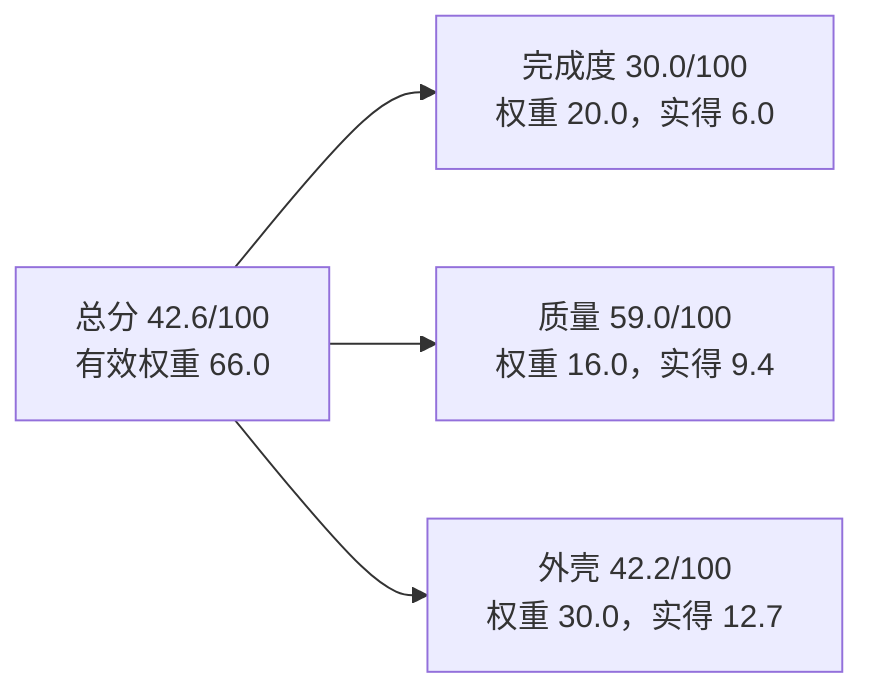
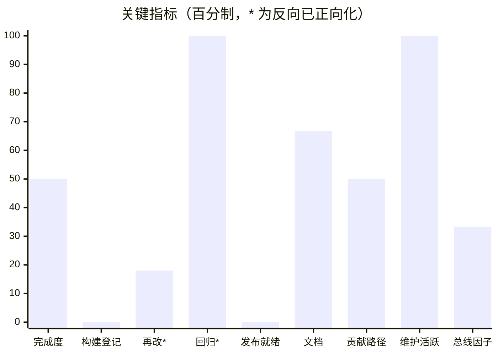
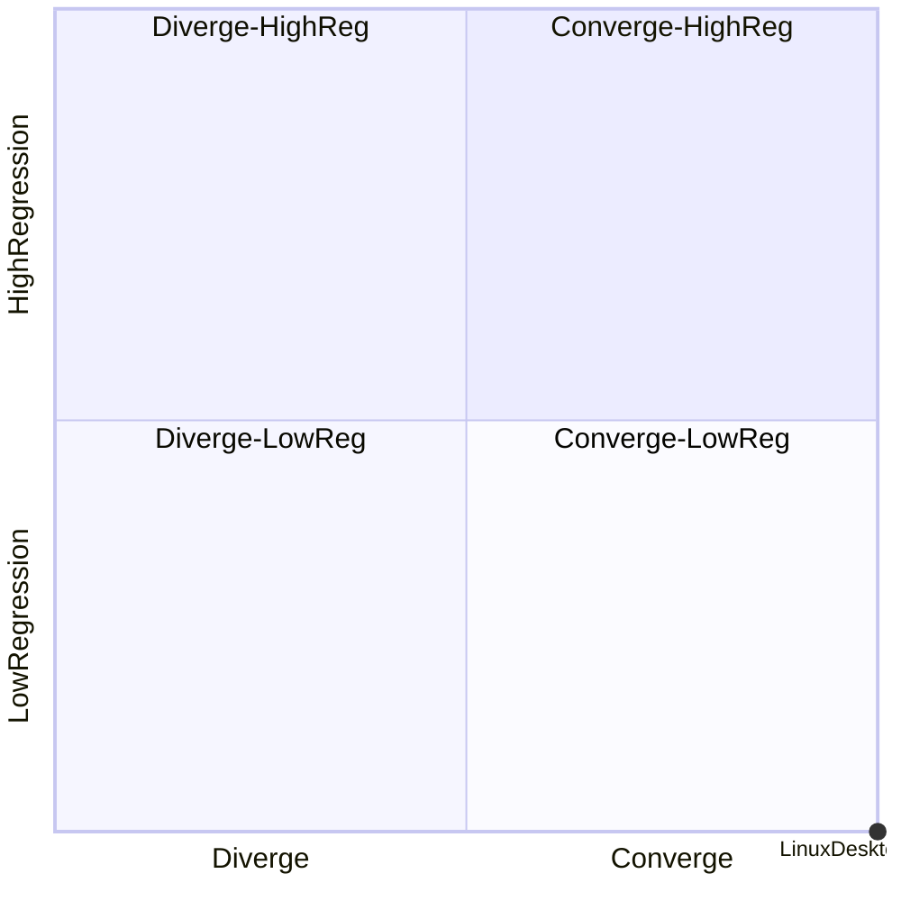

# 软件评估报告：LinuxDesktopPerfect

**报告关联信息**

| 项 | 值 |
|---|---|
| 仓库 | `linux-desktop-perfect`（`git@gitee.com:the50w/linux-desktop-perfect.git`） |
| 提交 | `9987f7d`（分支 `main`，1738 commits，tag 0） |
| 日期 | 2026-11-11 |
| 类型 / 版本 | application（运行时套件）/ 无版本声明、无 tag |
| 评估口径 | Software Assessment Kit（SAK）v1.2；权重合计 100；N/A 指标 4 个；有效权重 66.0 |
| 证据来源 | 提交历史（1738）、tag（0）、CI 配置（无）、判据脚本与读数、文档 |
| 原始数据 | `audit_out/{inventory,groups,metrics,scores}.json`、工具报告 `audit_out/REPORT-linux-desktop-perfect.md` |

## 0 结论摘要

**先加固再推进。总分 42.6/100，有效权重 66.0（<70，按 R8 只报区间、不做横向排名）。**
三层：完成度 **30.0/100**（最弱）、质量 59.0/100、外壳 42.2/100。
首要触发：**R4 当前版本未发布**（tag=0、无版本声明、无 CHANGELOG）；**R6 完成度 50.0% − 闸门 0.0% > 30pp**；**R8 有效权重不足**。
结构性事实：47 个功能团 **全部零用例**（179927 行），修复闭环率 **0.0**，RTM 三向覆盖 **0.0**，构建登记 **0.0**（本仓无 `.github/`）。







> 象限读法：x=1.00（修复趋势收敛）、y=0.00（回归率 0.0）→ 落在「收敛 + 低回归」⇒ **继续**。但 R4/R6 是硬缺口，因此决策卡的措辞是「先加固再推进」而非直接推进。

## 1 软件认知

**① 一句话定位**：LinuxDesktopPerfect 是 **WindowsDesktop 在 Linux 上的完整替代运行时** —— 让 WPF/WinForms 应用源码级重编后能在 Linux 桌面开窗、画字、输入、打印、被无障碍读到；服务对象是「有一份 WindowsDesktop 源码、不想重写 UI」的个人开发者与迁移到信创 Linux 的小团队（README「产品定义」）。

**② 核心机制**：托管层原样保留（上游 `dotnet/wpf` 只读快照），把 Windows 专有的原生面逐个换成 Linux 实现，再用自产的 `Microsoft.WindowsDesktop.App` 框架包把整条栈接回标准 `dotnet build`：

```text
WPF 源码 → 自产 Ref pack 编译 → 自产 Runtime pack 加载
              ↑                        ↓
        PresentationBuildTasks     native 面（shim/milcore/text/wic）
              ↑                        ↓
        自产 SDK targets ←──── X11 · Skia · HarfBuzz · Fontconfig · CUPS · AT-SPI · GStreamer
```

八个子系统（《概要设计》§4.1）：SYS-1 `wpf-port`（托管适配/PBT/applier）、SYS-2 `native-shim`（Win32/GDI/GDI+ 子集 → `libwpfwin32.so`）、SYS-3 `milcore`（DUCE → Skia → `libwpfgfx_linux.so`）、SYS-4 `text-stack`（字体/shaping/行布局 → `libdwlinux.so`）、SYS-5 `wic-dwrite`（图像解码/ICC → `libwpfwic.so`）、SYS-6 `pack`（Ref/Runtime pack + targets）、SYS-7 `winforms-compat`、SYS-8 `service-adapters`（打印/媒体/Ink/UIA/IME/DRM）。

**③ 运行形态**：**库 + 框架包**形态，不是独立进程。产出是 2 个 NuGet pack（Ref / Runtime）+ 4 个 `.so`；应用侧只写 `UseWPF=true` 即可解析到 Linux RID。开发期另有进程外探针（`50-verify/external/*`、Cecil 补丁器 `40-build/appliers/*`）用于验收。

**④ 边界与不变量**：不做二进制兼容；不承诺 WinForms 全控件/设计器/ActiveX；DRM 按 DQ-001 显式报错降级；上游快照只读、补丁只写在 applier 里；验收口径为「判据先行 + 无障碍优先」（先写失败判据拿红读数，UI 先看 AT-SPI 结构树、像素只作第二判据）。

### 1.1 证据边界

| 证据 | 能证明 | 不能证明 |
|---|---|---|
| 提交历史（1738） | 代码演进、修复节奏、作者集中度 | 需求合理性与验收结论 |
| tag / CHANGELOG（均无） | — | 任何发布正确性 |
| CI 配置（无 `.github/`） | — | 构建是否长期绿 |
| 判据脚本与读数（`50-verify/`、`30-design/checks/`） | 曾被跑过的断言与读数 | 覆盖率、用例级通过率 |
| 文档（README/CONTRIBUTING/30-design） | 有设计且与代码同仓演进 | 文档与代码一致 |

**本次评估的口径差异（必读）**：kit 的测试识别假设「`tests/` 顶层 + 单元测试」，而本仓的验证形态是 **判据脚本**（`50-verify/deliver-check.mjs` 21 项、`50-verify/degrade/audit.mjs`、`30-design/checks/*.mjs` 5 条门禁）。因此下列三项是**工具口径下的真实读数**，但**不等于本仓没有验证**：测试强度 `N/A`、修复闭环 `0.0`、RTM 三向覆盖 `0.0`。本报告按 kit 口径给分，同时在 §4.4 单列「实际验证形态」，不做分数修正（修正会破坏口径可比性）。

## 2 模块层级树

按《概要设计》八子系统重排（工具给的树是按目录切分，见工具报告 §2）：

```text
LinuxDesktopPerfect（1 个软件单元）
├── 托管移植层（wpf-port）                135204 行 / 36 团 / 0 用例
│   ├── 核心框架 · PresentationFramework      56758 行 · DoD 0.5
│   ├── 核心框架 · PresentationCore           24176 行 · DoD 0.5
│   ├── 核心框架 · WindowsBase                10301 行 · DoD 0.5
│   ├── 渲染 · WpfGfx（Interop/Commands/Rendering/Resources/Text/Windowing）  24760 行 · DoD 0.5
│   ├── 文本 · DirectWrite（Provider/Fallback/Probe/ClosedLoop…）            10124 行 · DoD 0.5
│   ├── 构建 · PresentationBuildTasks          1000 行 · DoD 0.5
│   └── 桩件 · CycleStub / ApiCycle / a11y     1795 行 · DoD 0.5
├── 原生 shim 层（native-shim）            35315 行（42 文件，**未进团**）
├── 渲染层（milcore）                      25781 行（73 文件，**未进团**）
├── 绘图兼容层（system-drawing-common）    44723 行 / 11 团 / 0 用例
├── 文本栈（text-stack）                     893 行（4 文件）
├── 图像/字体（wic-dwrite）                 3062 行（15 文件）
├── 包与工具（appliers 1209 + milcore-bridge 1728 + media-bridge 125 + zlib-native 144）
└── 验证与门禁（50-verify 2256 行 + 30-design/checks 5 条）—— **工具未识别**
```

## 3 功能团

工具自动切出 **47 个功能团**（明细见 `REPORT-linux-desktop-perfect.md` §3 表），覆盖 468 个源文件、179927 行。逐团 DoD 全部为 **0.5**（有实现、零直接用例）。

| 观察 | 数字 | 说明 |
|---|---:|---|
| 功能团数 | 47 | 超出 kit 建议的 10~25；本仓是 8 子系统的大规模移植，按子系统再切会粗到无法定位，故保留 |
| 零用例团 | 47（100%） | 全部团无用例 |
| 超大团 | 1 个 56758 行（PresentationFramework） | 单团超过 900 行上限 63 倍，其 DoD 会在加权时把整层拉向 0.5 |
| 覆盖文件 | 468 | 与 `git ls-files` 中 `40-build/{wpf-port,system-drawing-common}` 的 .cs 基本一致 |
| 未进团代码 | `native-shim` 35315 行、`milcore` 25781 行 | 工具按 `src_roots` 找 C 代码时未纳入这两块（C 文件在 `src/` 下但顶层路径不在白名单） |

## 4 指标

### 4.1 三层结论

| 层 | 得分 | 满分 | 百分制 | 关键数字 |
|---|---:|---:|---:|---|
| 完成度 | 6.0 | 20.0 | **30.0** | 加权完成度 0.5；闸门 N/A；构建登记 0.0 |
| 质量 | 9.4 | 16.0 | **59.0** | 缺陷密度 N/A；闭环 N/A（0.0）；再改 0.36 → 18.0；回归 0.0 → 100 |
| 外壳 | 12.7 | 30.0 | **42.2** | 发布 0.0；文档 0.667；贡献 0.5；总线因子 0.333 |

### 4.2 指标明细

| 指标 | 原值 | 百分制 | 判读 |
|---|---:|---:|---|
| 加权完成度 | 0.50 | 50.0 | 全部团卡在「有实现、零用例」档 |
| 构建登记 | 0.0 | 0.0 | **无 `.github/`**（事实，非口径） |
| 再改率（L2 跨批次） | 0.36 | 18.0 | 跨批次回归 36%，低于 bad=0.40，未触 R1 |
| 回归率（L1 模块） | 0.0 | 100 | 30 天后相邻模块零再修 |
| 修复闭环 | 0.0 | N/A | 137 个 fix 无一同时改 `tests/`（本仓无单元测试形态） |
| 缺陷密度 | — | N/A | KLOC 取 `src/` 顶层命中 0，口径断裂 |
| 测试强度 | — | N/A | 同上 |
| 发布就绪 | 0.0 | 0.0 | tag=0、无版本声明、无 CHANGELOG |
| 文档完备度 | 0.667 | 66.7 | README/LICENSE/CONTRIBUTING/.gitignore 有；**缺 CHANGELOG、ISSUE_TEMPLATE** |
| 贡献路径 | 0.5 | 50.0 | 有 CONTRIBUTING，无 ISSUE 模板 |
| 维护活跃 | 1.0 | 100 | 静默 0 天 |
| 总线因子 | 0.333 | 33.3 | 1738 提交全部来自 1 位作者（`the50w`），别名合并后仍 100% |

### 4.3 方法论指标

| 指标 | 读数 | 判读 |
|---|---|---|
| 严重度分布 | P3=3 / P2=127 / P1=7 段 | 无 P0；加权关闭量 270 |
| 净质量变化 | 全历史 +109，近 30 天 +109 | 正值为净改善 |
| 缺陷双曲线 | 2026-10 gap=0 → 2026-11 gap=0 | 修复追平引入 |
| 泊松显著性 | λ=10.172，观测 35，p≈0 | 单点不构成劣化结论（样本口径见 §8 纪律） |
| 逃逸率 / DRE | 0.0 / 1.0 | 无跟踪器 ⇒ 仅作方向（代理/未自证） |
| 覆盖率 | 0 个 cobertura 产物 | 无覆盖率数据 |
| RTM 三向覆盖 | 0.0 | 有用例且有文档的团 = 0 |

### 4.4 实际验证形态（工具未识别，单列不修正分数）

| 形态 | 位置 | 规模 | 是否跑过 |
|---|---|---|---|
| 交付自检 | `50-verify/deliver-check.mjs` | L1 15 项 + L2 6 项（`--with-gui`） | 是（本会话多次 21/21） |
| 降级与 K 号审计 | `50-verify/degrade/audit.mjs` | ACC-030，PASS diff=0 | 是（每次改仓必跑） |
| 文档门禁 | `30-design/checks/*.mjs` | 5 条（links/package/design-ids/coverage/selftest） | 是（rc=0） |
| 进程外能力判据 | `50-verify/读数/` | 四链哈希、15 类能力读数 | 是 |
| 单元测试 | `40-build/native-shim/tests`、`40-build/text-stack/tests` | 仅 2 处，未接入门禁 | 未见自动执行 |

结论：本仓的「测试」是**判据 + 门禁**而非单元测试，kit 的三项 0 分反映的是**形态不匹配**，不是「没验证」。但按 kit 纪律，我不改分数，只在此披露。

## 5 决策与触发

| 规则 | 表达式 | 本仓读数 | 结论 |
|---|---|---|---|
| R1 | 相邻失败率 > 0.183 | 0.0 | 未触发 |
| R2 | Δ加权缺陷存量 ≥ 0 | 0（双曲线 gap=0） | 未触发 |
| R3 | 静默 > 30 天 | 0 天 | 未触发 |
| **R4** | tag=0 / 三处不一致 | tag=0、无版本、无 CHANGELOG | **触发 → P0** |
| R5 | 1−闭环率 > 0.50 | 1−0 = 1.0（但闭环口径 N/A） | 口径不足，不据此立规矩 |
| **R6** | 完成度−闸门 > 0.30 | 0.50 − 0.0 = 0.50 | **触发 → 补闸门** |
| R7 | 模块级样本不足直接 N/A | 已降级（L2 跨批次） | 已执行 |
| **R8** | 有效权重 < 70 | 66.0 | **触发 → 只报区间、不排名** |
| R9 | 跨批次与批次内未分开 | 已分开（L2 跨批次 0.36） | 合规 |

四象限：**收敛（x=1.00）× 低回归（y=0.00）** ⇒ 规则判「继续推进」；但 R4/R6 是硬缺口，实际决策为**先加固再推进**（补齐发布与闸门后再谈推进）。

## 6 行动清单（按 得分增量/工作量 排序）

| P | 动作 | 影响指标 | 预估增量 | 工作量 | 依据 |
|---|---|---|---:|---|---|
| **P0** | 打首个版本 tag，补 `CHANGELOG.md`，让「版本声明 / CHANGELOG 顶条 / tag 指向提交」三处一致 | 发布就绪 + R4 | **+10** | 0.2d | R4 触发；tag=0 是唯一「完全没交付」的硬缺口 |
| **P0** | 补 `.github/ISSUE_TEMPLATE/`（bug + feature 两个模板） | 贡献路径 + 文档完备度 | **+4.5** | 0.3d | 文档 4/6 → 6/6 |
| **P1** | 建立覆盖率闸门：把现有判据接入 CI（`.github/workflows/`），至少在 `wpf-port`/`native-shim` 上跑 `deliver-check` | 构建登记 0.0 → 1.0，闸门 0 → >0 | **+5~8** | 1.5d | R6 触发；当前无 `.github/` |
| **P1** | 把 `50-verify/` 的判据「用例化」：每个功能团至少 1 条可机读断言（现在 47 团全零用例） | 加权完成度 0.5 → 0.7+ | **+4.8~9.6** | 2~3d | 47/47 团零用例；补 1 条即升到 0.7 档 |
| **P2** | 补 `native-shim`（35315 行）与 `milcore`（25781 行）的团归属 | 加权完成度口径完整性 | 口径修复 | 0.5d | 工具未纳入这 6 万行，完成度分母偏小 |
| **P2** | 拆 `PresentationFramework`（56758 行 1 团）为 3~5 个团 | 完成度可定位性 | 无量纲增量 | 0.5d | 超 900 行上限 63 倍，掩盖内部差异 |
| **P2** | 引入第二维护者或明确 bus-factor 缓解（文档化关键路径） | 总线因子 33.3 → 66.7+ | **+1.7** | 持续 | 1738 提交/1 人 |

## 7 仓库记录

- 提交 **1738**｜分支 `main`｜tag **0**｜静默 **0 天**（最后提交 2026-11-11）
- 修复提交 **137**（产品 fix 59）｜defective fix rate **0.1724**｜CFR **0.0017**
- 作者：`the50w`（1738/1738，别名合并后仍 100%）
- 文件级事件 75｜跨批次再改 0.36｜带测试的修复提交 2（guard_ratio 0.0064）
- 文档：README ✓ / LICENSE ✓ / CONTRIBUTING ✓ / .gitignore ✓ / CHANGELOG ✗ / ISSUE_TEMPLATE ✗
- 语言构成：C#（`wpf-port` 149k、`system-drawing-common` 45k）、C（`native-shim` 35k、`wic-dwrite` 3k）、脚本（判据 mjs）
- 上游只读快照 `40-build/upstream/`（约 3.6M 行）**不计入**本软件源码

## 8 口径纪律说明（本次踩到的坑）

1. **上游快照必须排除**：首次 scan 把 `40-build/upstream/`（9366 文件、3.6M 行）算成软件，得 685 团、用例 1；排除后才回到 47 团。原因是 kit 的 `exclude_dirs` 不含 `upstream`。
2. **3 个 unit 实为 1 个软件**：工具按顶层目录切成 `40-build` / `50-verify` / `src` 三份，各出一行索引；本报告合并为一，按 8 子系统叙述。
3. **`src_lines` 口径断裂**：工具找顶层 `src/` 命中 0，导致缺陷密度与测试强度双 N/A；实际源码行以 `groups.json` 的 179927（进团）+ 61093（未进团）为准。
4. **测试形态不匹配**：本仓无 `tests/` 顶层单元测试，验证靠 `50-verify/` 判据与 5 条门禁；kit 的闭环/RTM/测试强度三项因此为 0/N/A，已单列说明、不修正分数。
5. **首轮 scan 未排除本地构建产物**：`40-build/build/`（139M，git 未跟踪）已被 `exclude_dirs` 的 `build` 命中，但统计脚本若不排除会虚增 222 万行。

> 复跑命令（产物只写 `audit_out/`）：
> ```bash
> python3 /tmp/sak/software_assessment_kit.py scan --repo . --out audit_out
> # 去重 groups.json 为单一软件后
> python3 /tmp/sak/software_assessment_kit.py run --repo . --out audit_out --groups audit_out/groups.json
> ```
