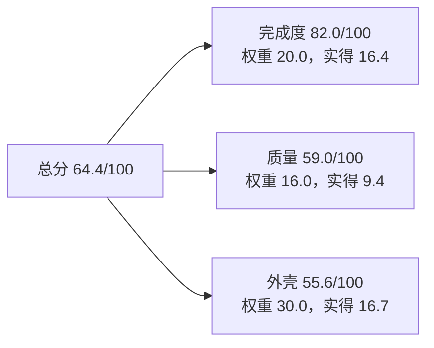
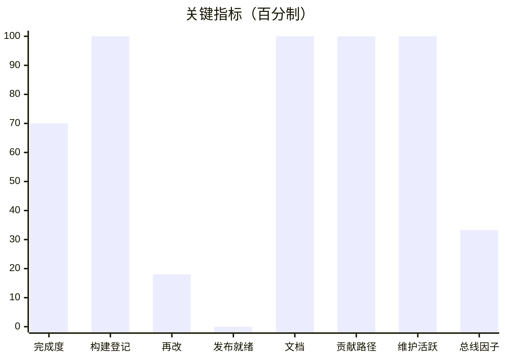
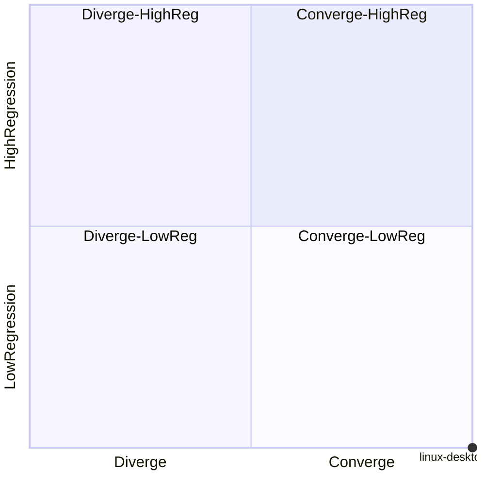

# 软件评估报告：linux-desktop-perfect

**报告关联信息**

| 项 | 值 |
|---|---|
| 仓库 | `linux-desktop-perfect` |
| 提交 | `a37be4a` |
| 日期 | 2026-11-12 |
| 类型 / 版本 | application / unknown |
| 评估口径 | Software Assessment Kit（SAK）v1.2；权重合计 100；N/A 指标 4 个 |
| 证据来源 | 提交历史、tag、CI 配置、测试产物、文档 |

## 0 结论摘要

**先加固再推进**。总分 **64.4/100**；三层得分：完成度 82.0/100、质量 59.0/100、外壳 55.6/100（层得分 ≠ 加权完成度，后者见 §4.2）。

- 最弱一层：外壳（55.6/100）；首要触发的规则：R4 当前版本未发布 / 版本三处不一致
- 完成度缺口集中在 0 个零用例功能团（0 行），外加 47 个用例 <3 的薄覆盖团
- 代理项：闸门覆盖、缺陷密度、修复闭环、测试强度；这些值不作为硬结论，只用于方向判断







> 象限读法：x=1.00（近两月修复趋势），y=0.00。四象限按右上/左上/左下/右下依次为「补回归用例 / 停手 / 补测试 / 继续」。

## 1 软件认知

> 工具给元数据与骨架，下列四段结论必须由 agent 依据源码与文档补全。

- 清单（256 个）：`40-build/appliers/commit-minreq/commit-minreq.csproj`、`40-build/appliers/commit-noconfirm/commit-noconfirm.csproj`、`40-build/appliers/dw-fontstrip/dw-fontstrip.csproj`、`40-build/appliers/gong-dnd/gong-dnd.csproj`、`40-build/appliers/loglabel-brush/loglabel-brush.csproj`、`40-build/appliers/sdc-inject/sdc-inject.csproj`、`40-build/appliers/seticon-ret/seticon-ret.csproj`、`40-build/appliers/wb-registry/wb-registry.csproj`、`40-build/milcore-bridge/MilBridge.Linux.csproj`、`40-build/milcore/WpfGfx.Linux.csproj`、`40-build/system-drawing-common/System.Drawing.Common.csproj`、`40-build/system-drawing-common/SystemDrawingCommon.Linux.csproj` …等 256 个
- 入口：`40-build/appliers/commit-minreq/Program.cs`、`40-build/appliers/commit-noconfirm/Program.cs`、`40-build/appliers/dw-fontstrip/Program.cs`、`40-build/appliers/gong-dnd/Program.cs`
- 规模：3807609 行 / 47 个功能团；仓库测试 0 行、用例 47 个（本次归属统计）

**待补全**：① 一句话定位 ② 核心机制（数据/请求如何流动）③ 运行形态 ④ 边界与不变量

### 1.1 证据边界

| 证据 | 能证明 | 不能证明 |
|---|---|---|
| 提交历史 | 代码演进、修复节奏、作者集中度 | 需求合理性与验收结论 |
| tag / CHANGELOG | 发布意图与版本声明 | 包是否真的可下载（离线时） |
| 测试产物（TRX） | 曾经跑过的通过率 | 现在仍然通过 |
| 文档 | 有文档且被提及 | 文档与代码一致 |

## 2 模块层级树

```text
linux-desktop-perfect（软件单元，3807609 行，47 个功能团）
├── wpf-port（135204 行 / 36 用例）
│   └── src（135204 行 / 36 团）
│       ├── Microsoft.DotNet.Wpf.Linux·PresentationFramework · 56758 行 · 1 用例 · DoD 0.7
│       ├── Microsoft.DotNet.Wpf.Linux·PresentationCore · 24176 行 · 1 用例 · DoD 0.7
│       ├── WpfGfx·Interop · 11720 行 · 1 用例 · DoD 0.7
│       ├── Microsoft.DotNet.Wpf.Linux·WindowsBase · 10301 行 · 1 用例 · DoD 0.7
│       ├── DirectWrite·Provider · 6000 行 · 1 用例 · DoD 0.7
│       ├── WpfGfx·Commands · 5459 行 · 1 用例 · DoD 0.7
│       ├── WpfGfx·Rendering · 4822 行 · 1 用例 · DoD 0.7
│       ├── WpfGfx·Resources · 2057 行 · 1 用例 · DoD 0.7
│       ├── Microsoft.DotNet.Wpf.Linux·DirectWriteForwarder · 1756 行 · 1 用例 · DoD 0.7
│       ├── WpfGfx·Windowing · 1685 行 · 1 用例 · DoD 0.7
│       ├── DirectWrite·FallbackCriteria · 1414 行 · 1 用例 · DoD 0.7
│       ├── WpfGfx·Text · 1033 行 · 1 用例 · DoD 0.7
│       ├── Microsoft.DotNet.Wpf.Linux·PresentationBuildTasks · 1000 行 · 1 用例 · DoD 0.7
│       ├── Microsoft.DotNet.Wpf.Linux·a11y · 893 行 · 1 用例 · DoD 0.7
│       ├── Microsoft.DotNet.Wpf.Linux·System.Printing · 871 行 · 1 用例 · DoD 0.7
│       ├── WpfGfx·Contracts · 684 行 · 1 用例 · DoD 0.7
│       ├── DirectWrite·WiringSmoke · 666 行 · 1 用例 · DoD 0.7
│       ├── DirectWrite·WicClosedLoop · 545 行 · 1 用例 · DoD 0.7
│       ├── DirectWrite·Probe · 412 行 · 1 用例 · DoD 0.7
│       ├── Microsoft.DotNet.Wpf.Linux·ReachFramework · 407 行 · 1 用例 · DoD 0.7
│       ├── Microsoft.DotNet.Wpf.Linux·CycleStub.PresentationUI · 400 行 · 1 用例 · DoD 0.7
│       ├── Microsoft.DotNet.Wpf.Linux·System.Xaml · 344 行 · 1 用例 · DoD 0.7
│       ├── DirectWrite·WicWriteClosedLoop · 313 行 · 1 用例 · DoD 0.7
│       ├── Microsoft.DotNet.Wpf.Linux·CycleStub.PresentationFramework · 262 行 · 1 用例 · DoD 0.7
│       ├── Microsoft.DotNet.Wpf.Linux·PresentationFramework.Classic · 218 行 · 1 用例 · DoD 0.7
│       ├── Microsoft.DotNet.Wpf.Linux·UIAutomationTypes · 204 行 · 1 用例 · DoD 0.7
│       ├── Microsoft.DotNet.Wpf.Linux·System.Windows.Extensions · 197 行 · 1 用例 · DoD 0.7
│       ├── DirectWrite·SystemFontsProbe · 164 行 · 1 用例 · DoD 0.7
│       ├── DirectWrite·FontEntryClosedLoop · 151 行 · 1 用例 · DoD 0.7
│       ├── Microsoft.DotNet.Wpf.Linux·CycleStub.ReachFramework · 101 行 · 1 用例 · DoD 0.7
│       ├── DirectWrite·WicSeamProbe · 63 行 · 1 用例 · DoD 0.7
│       ├── Microsoft.DotNet.Wpf.Linux·System.Windows.Controls.Ribbon · 56 行 · 1 用例 · DoD 0.7
│       ├── Microsoft.DotNet.Wpf.Linux·System.Windows.Input.Manipulations · 32 行 · 1 用例 · DoD 0.7
│       ├── Microsoft.DotNet.Wpf.Linux·UIAutomationProvider · 22 行 · 1 用例 · DoD 0.7
│       ├── Microsoft.DotNet.Wpf.Linux·SystemPrinting.ApiCycle · 14 行 · 1 用例 · DoD 0.7
│       └── Microsoft.DotNet.Wpf.Linux·ReachFramework.ApiCycle · 4 行 · 1 用例 · DoD 0.7
└── system-drawing-common（44723 行 / 11 用例）
    └── src（44723 行 / 11 团）
        ├── System·Drawing（散件） · 24228 行 · 1 用例 · DoD 0.7
        ├── Drawing·Printing · 7904 行 · 1 用例 · DoD 0.7
        ├── Drawing·Imaging · 5541 行 · 1 用例 · DoD 0.7
        ├── Drawing·Drawing2D · 4128 行 · 1 用例 · DoD 0.7
        ├── misc·GDI · 1124 行 · 1 用例 · DoD 0.7
        ├── system-drawing-common·CommonInterop · 613 行 · 1 用例 · DoD 0.7
        ├── Drawing·Internal · 413 行 · 1 用例 · DoD 0.7
        ├── system-drawing-common·misc（散件） · 382 行 · 1 用例 · DoD 0.7
        ├── Drawing·Text · 311 行 · 1 用例 · DoD 0.7
        ├── Drawing·Design · 48 行 · 1 用例 · DoD 0.7
        └── 40-build·system-drawing-common（散件） · 31 行 · 1 用例 · DoD 0.7
```

## 3 功能团（模块层级路径 + 项目路径）

| 功能团 | 模块层级路径 | 项目路径 | 行数 | 文件 | 用例 | 文档 | DoD | 缺口 |
|---|---|---|---:|---:|---:|:--:|---:|---|
| Microsoft.DotNet.Wpf.Linux·PresentationFramework | wpf-port/src | `40-build/wpf-port/src/Microsoft.DotNet.Wpf.Linux/src/PresentationFramework` | 56758 | 39 | 1 | Y | 0.7 | 用例<3 |
| System·Drawing（散件） | system-drawing-common/src | `40-build/system-drawing-common/src/System/Drawing/ (root)` | 24228 | 88 | 1 | Y | 0.7 | 用例<3 |
| Microsoft.DotNet.Wpf.Linux·PresentationCore | wpf-port/src | `40-build/wpf-port/src/Microsoft.DotNet.Wpf.Linux/src/PresentationCore` | 24176 | 21 | 1 | Y | 0.7 | 用例<3 |
| WpfGfx·Interop | wpf-port/src | `40-build/wpf-port/src/Microsoft.DotNet.Wpf.Linux/src/WpfGfx/Interop` | 11720 | 23 | 1 | Y | 0.7 | 用例<3 |
| Microsoft.DotNet.Wpf.Linux·WindowsBase | wpf-port/src | `40-build/wpf-port/src/Microsoft.DotNet.Wpf.Linux/src/WindowsBase` | 10301 | 10 | 1 | Y | 0.7 | 用例<3 |
| Drawing·Printing | system-drawing-common/src | `40-build/system-drawing-common/src/System/Drawing/Printing` | 7904 | 46 | 1 | Y | 0.7 | 用例<3 |
| DirectWrite·Provider | wpf-port/src | `40-build/wpf-port/src/Microsoft.DotNet.Wpf.Linux/src/DirectWrite/Provider` | 6000 | 20 | 1 | Y | 0.7 | 用例<3 |
| Drawing·Imaging | system-drawing-common/src | `40-build/system-drawing-common/src/System/Drawing/Imaging` | 5541 | 42 | 1 | Y | 0.7 | 用例<3 |
| WpfGfx·Commands | wpf-port/src | `40-build/wpf-port/src/Microsoft.DotNet.Wpf.Linux/src/WpfGfx/Commands` | 5459 | 9 | 1 | N | 0.7 | 用例<3 |
| WpfGfx·Rendering | wpf-port/src | `40-build/wpf-port/src/Microsoft.DotNet.Wpf.Linux/src/WpfGfx/Rendering` | 4822 | 15 | 1 | N | 0.7 | 用例<3 |
| Drawing·Drawing2D | system-drawing-common/src | `40-build/system-drawing-common/src/System/Drawing/Drawing2D` | 4128 | 42 | 1 | Y | 0.7 | 用例<3 |
| WpfGfx·Resources | wpf-port/src | `40-build/wpf-port/src/Microsoft.DotNet.Wpf.Linux/src/WpfGfx/Resources` | 2057 | 6 | 1 | N | 0.7 | 用例<3 |
| Microsoft.DotNet.Wpf.Linux·DirectWriteForwarder | wpf-port/src | `40-build/wpf-port/src/Microsoft.DotNet.Wpf.Linux/src/DirectWriteForwarder` | 1756 | 4 | 1 | Y | 0.7 | 用例<3 |
| WpfGfx·Windowing | wpf-port/src | `40-build/wpf-port/src/Microsoft.DotNet.Wpf.Linux/src/WpfGfx/Windowing` | 1685 | 6 | 1 | N | 0.7 | 用例<3 |
| DirectWrite·FallbackCriteria | wpf-port/src | `40-build/wpf-port/src/Microsoft.DotNet.Wpf.Linux/src/DirectWrite/FallbackCriteria` | 1414 | 4 | 1 | Y | 0.7 | 用例<3 |
| misc·GDI | system-drawing-common/src | `40-build/system-drawing-common/src/misc/GDI` | 1124 | 10 | 1 | Y | 0.7 | 用例<3 |
| WpfGfx·Text | wpf-port/src | `40-build/wpf-port/src/Microsoft.DotNet.Wpf.Linux/src/WpfGfx/Text` | 1033 | 9 | 1 | Y | 0.7 | 用例<3 |
| Microsoft.DotNet.Wpf.Linux·PresentationBuildTasks | wpf-port/src | `40-build/wpf-port/src/Microsoft.DotNet.Wpf.Linux/src/PresentationBuildTasks` | 1000 | 3 | 1 | Y | 0.7 | 用例<3 |
| Microsoft.DotNet.Wpf.Linux·a11y | wpf-port/src | `40-build/wpf-port/src/Microsoft.DotNet.Wpf.Linux/src/a11y` | 893 | 3 | 1 | Y | 0.7 | 用例<3 |
| Microsoft.DotNet.Wpf.Linux·System.Printing | wpf-port/src | `40-build/wpf-port/src/Microsoft.DotNet.Wpf.Linux/src/System.Printing` | 871 | 2 | 1 | Y | 0.7 | 用例<3 |
| WpfGfx·Contracts | wpf-port/src | `40-build/wpf-port/src/Microsoft.DotNet.Wpf.Linux/src/WpfGfx/Contracts` | 684 | 5 | 1 | N | 0.7 | 用例<3 |
| DirectWrite·WiringSmoke | wpf-port/src | `40-build/wpf-port/src/Microsoft.DotNet.Wpf.Linux/src/DirectWrite/WiringSmoke` | 666 | 2 | 1 | Y | 0.7 | 用例<3 |
| system-drawing-common·CommonInterop | system-drawing-common/src | `40-build/system-drawing-common/src/CommonInterop` | 613 | 14 | 1 | Y | 0.7 | 用例<3 |
| DirectWrite·WicClosedLoop | wpf-port/src | `40-build/wpf-port/src/Microsoft.DotNet.Wpf.Linux/src/DirectWrite/WicClosedLoop` | 545 | 1 | 1 | Y | 0.7 | 用例<3 |
| Drawing·Internal | system-drawing-common/src | `40-build/system-drawing-common/src/System/Drawing/Internal` | 413 | 4 | 1 | Y | 0.7 | 用例<3 |
| DirectWrite·Probe | wpf-port/src | `40-build/wpf-port/src/Microsoft.DotNet.Wpf.Linux/src/DirectWrite/Probe` | 412 | 2 | 1 | Y | 0.7 | 用例<3 |
| Microsoft.DotNet.Wpf.Linux·ReachFramework | wpf-port/src | `40-build/wpf-port/src/Microsoft.DotNet.Wpf.Linux/src/ReachFramework` | 407 | 4 | 1 | Y | 0.7 | 用例<3 |
| Microsoft.DotNet.Wpf.Linux·CycleStub.PresentationUI | wpf-port/src | `40-build/wpf-port/src/Microsoft.DotNet.Wpf.Linux/src/CycleStub.PresentationUI` | 400 | 3 | 1 | Y | 0.7 | 用例<3 |
| system-drawing-common·misc（散件） | system-drawing-common/src | `40-build/system-drawing-common/src/misc/ (root)` | 382 | 5 | 1 | Y | 0.7 | 用例<3 |
| Microsoft.DotNet.Wpf.Linux·System.Xaml | wpf-port/src | `40-build/wpf-port/src/Microsoft.DotNet.Wpf.Linux/src/System.Xaml` | 344 | 1 | 1 | Y | 0.7 | 用例<3 |
| DirectWrite·WicWriteClosedLoop | wpf-port/src | `40-build/wpf-port/src/Microsoft.DotNet.Wpf.Linux/src/DirectWrite/WicWriteClosedLoop` | 313 | 1 | 1 | Y | 0.7 | 用例<3 |
| Drawing·Text | system-drawing-common/src | `40-build/system-drawing-common/src/System/Drawing/Text` | 311 | 8 | 1 | Y | 0.7 | 用例<3 |
| Microsoft.DotNet.Wpf.Linux·CycleStub.PresentationFramework | wpf-port/src | `40-build/wpf-port/src/Microsoft.DotNet.Wpf.Linux/src/CycleStub.PresentationFramework` | 262 | 1 | 1 | Y | 0.7 | 用例<3 |
| Microsoft.DotNet.Wpf.Linux·PresentationFramework.Classic | wpf-port/src | `40-build/wpf-port/src/Microsoft.DotNet.Wpf.Linux/src/PresentationFramework.Classic` | 218 | 1 | 1 | Y | 0.7 | 用例<3 |
| Microsoft.DotNet.Wpf.Linux·UIAutomationTypes | wpf-port/src | `40-build/wpf-port/src/Microsoft.DotNet.Wpf.Linux/src/UIAutomationTypes` | 204 | 2 | 1 | Y | 0.7 | 用例<3 |
| Microsoft.DotNet.Wpf.Linux·System.Windows.Extensions | wpf-port/src | `40-build/wpf-port/src/Microsoft.DotNet.Wpf.Linux/src/System.Windows.Extensions` | 197 | 1 | 1 | Y | 0.7 | 用例<3 |
| DirectWrite·SystemFontsProbe | wpf-port/src | `40-build/wpf-port/src/Microsoft.DotNet.Wpf.Linux/src/DirectWrite/SystemFontsProbe` | 164 | 1 | 1 | Y | 0.7 | 用例<3 |
| DirectWrite·FontEntryClosedLoop | wpf-port/src | `40-build/wpf-port/src/Microsoft.DotNet.Wpf.Linux/src/DirectWrite/FontEntryClosedLoop` | 151 | 1 | 1 | Y | 0.7 | 用例<3 |
| Microsoft.DotNet.Wpf.Linux·CycleStub.ReachFramework | wpf-port/src | `40-build/wpf-port/src/Microsoft.DotNet.Wpf.Linux/src/CycleStub.ReachFramework` | 101 | 1 | 1 | Y | 0.7 | 用例<3 |
| DirectWrite·WicSeamProbe | wpf-port/src | `40-build/wpf-port/src/Microsoft.DotNet.Wpf.Linux/src/DirectWrite/WicSeamProbe` | 63 | 1 | 1 | Y | 0.7 | 用例<3 |
| Microsoft.DotNet.Wpf.Linux·System.Windows.Controls.Ribbon | wpf-port/src | `40-build/wpf-port/src/Microsoft.DotNet.Wpf.Linux/src/System.Windows.Controls.Ribbon` | 56 | 1 | 1 | Y | 0.7 | 用例<3 |
| Drawing·Design | system-drawing-common/src | `40-build/system-drawing-common/src/System/Drawing/Design` | 48 | 1 | 1 | Y | 0.7 | 用例<3 |
| Microsoft.DotNet.Wpf.Linux·System.Windows.Input.Manipulations | wpf-port/src | `40-build/wpf-port/src/Microsoft.DotNet.Wpf.Linux/src/System.Windows.Input.Manipulations` | 32 | 1 | 1 | Y | 0.7 | 用例<3 |
| 40-build·system-drawing-common（散件） | system-drawing-common/src | `40-build/system-drawing-common/src/ (root)` | 31 | 1 | 1 | Y | 0.7 | 用例<3 |
| Microsoft.DotNet.Wpf.Linux·UIAutomationProvider | wpf-port/src | `40-build/wpf-port/src/Microsoft.DotNet.Wpf.Linux/src/UIAutomationProvider` | 22 | 1 | 1 | Y | 0.7 | 用例<3 |
| Microsoft.DotNet.Wpf.Linux·SystemPrinting.ApiCycle | wpf-port/src | `40-build/wpf-port/src/Microsoft.DotNet.Wpf.Linux/src/SystemPrinting.ApiCycle` | 14 | 1 | 1 | Y | 0.7 | 用例<3 |
| Microsoft.DotNet.Wpf.Linux·ReachFramework.ApiCycle | wpf-port/src | `40-build/wpf-port/src/Microsoft.DotNet.Wpf.Linux/src/ReachFramework.ApiCycle` | 4 | 1 | 1 | Y | 0.7 | 用例<3 |

加权完成度 **82.0/100**（47 团 / 179927 行）；零用例 0 行（0.0%）。

## 4 指标

### 4.1 三层结论

本节把总分拆成三层：完成度看「做完没有」，质量看「做得可不可靠」，外壳看「送不送得出去」。百分制便于横向比较，满分权重见每行第三列。

| 层 | 得分 | 满分 | 百分制 | 关键数字 |
|---|---:|---:|---:|---|
| 完成度 | 16.4 | 20.0 | 82.0 | 闸门覆盖 None｜构建登记 1.0 |
| 质量 | 9.4 | 16.0 | 59.0 | 缺陷密度 None｜闭环 None｜再改 0.36 |
| 外壳 | 16.7 | 30.0 | 55.6 | 发布 0.0｜文档 1.0｜贡献 1.0 |

### 4.2 指标明细（百分制）

本节逐项列出原始值与百分制。原值是口径内的真实数字（比例、密度、天数）；百分制是归一后可直接比较的分数，反向指标（缺陷密度/再改/回归）已正向化。

| 指标 | 含义 | 原值 | 百分制 |
|---|---|---:|---:|
| 完成度 | 功能团行数加权的 DoD 完成度 | 0.7 | 70.0 |
| 闸门覆盖 | 有覆盖率闸门的源码行占比 | — | — |
| 构建登记 | CI 中登记的项目 / 全部项目 | 1.0 | 100.0 |
| 缺陷密度 | 每千行源码的缺陷修复数（反向） | — | — |
| 修复闭环 | 同提交带测试的修复 / 产品修复 | — | — |
| 再改率 | 30 天后同模块再修比例（反向） | 0.36 | 18.0 |
| 回归率 | 30 天后相邻模块再修比例（反向） | 0.0 | 100.0 |
| 测试强度 | 测试源码比与用例密度的综合 | — | — |
| 发布就绪 | 版本/tag/CHANGELOG 三处一致 | 0.0 | 0.0 |
| 文档完备度 | 六类基础文档的命中率 | 1.0 | 100.0 |
| 贡献路径 | 根 CONTRIBUTING + ISSUE 模板 | 1.0 | 100.0 |
| 维护活跃 | 最近提交距今的活跃度 | 1.0 | 100.0 |
| 总线因子 | 近 90 天贡献者集中度 | 0.3333 | 33.3 |

### 4.3 方法论指标（修一个出几个的量化）

| 指标 | 代入 | 结果 | 判读 |
|---|---|---|---|
| 严重度分布 | {'3': 3, '2': 127, '1': 7} | 加权关闭 270 | 存在高危缺陷 |
| 净质量变化 | 加权关闭 − 修复引入 | 全历史 109.0，近 30 天 109.0 | 正值为净改善 |
| 缺陷双曲线 | 2026-10 gap=0 → 2026-11 gap=0 | 末段 gap=0 | gap 收敛=修复追平引入 |
| 泊松显著性 | λ=10.172，观测 35，p=0.0 | 按 p 值判 | 单点不构成劣化结论 |
| 地震带 | 40-build·system-drawing-common（散件）（扇入 0/churn 0）、system-drawing-common·CommonInterop（扇入 0/churn 0）、System·Drawing（散件）（扇入 0/churn 0） | — | 优先补这些位置的契约测试 |
| 逃逸率 / DRE | 0.0 / 1.0 | 参考 | 无跟踪器时只作方向 |
| 覆盖率 | 0 个 cobertura | None | 仅代表有产物的子集 |
| RTM 三向覆盖 | 有用例且有文档 / 总团 | 0.8936 | 越低说明越多元件缺证据 |

> 技术实诚：无 Issue 跟踪器时，逃逸率与净质量变化都是**代理**；泊松样本 <10 时不作劣化判定。

## 5 决策与触发

本节把预先声明的规则代入本软件，得到「继续推进 / 先加固 / 停手」的判据；任一规则触发即需在行动清单里给出对应动作。

- R4 当前版本未发布 / 版本三处不一致
- R6 完成度 70.0% - 闸门 0.0% > 30pp

## 6 行动清单（按 得分增量/工作量 排序）

得分增量 = 该动作能把对应指标提升多少（权重 × 归一差），工作量按常见投入估算。

| P | 动作 | 影响指标 | 得分增量 | 工作量 |
|---|---|---|---:|---|
| P0 | 打当前版本 tag、跑发布流水线，并把 CHANGELOG 对齐到该版本 | 发布就绪 | +10 | 0.2d |
| P1 | 覆盖率闸门扩到核心库（当前仅覆盖 0% 源码，目标 90%） | 闸门覆盖 | +5.0 | 1.5d |
| P2 | 给 47 个用例过薄的功能团（<3 用例）补到 3 个以上 | 加权完成度 | +2.4 | 1d |

## 7 仓库记录

- 提交 1741｜分支 2｜tag 0｜静默 0 天
- 修复 137（产品 59）｜defective fix 0.1724｜CFR 0.0017
- 作者：the50w
